# Agentic AI for Video Creation — Learner Guide

C436 · Version 4.0 · Tertiary Infotech Academy Pte Ltd (UEN 201200696W)

## How to Use This Guide

This guide explains every idea in the course and carries the full step-by-step for every lab, with the reasoning behind each step. The slides introduce the idea; this guide is what you follow at the keyboard and keep as your reference after the course. Every lab also has its own folder in the lab pack with a README (PDF), a prompt page with one-click copy, the prompts as PDF, mock assets and an evidence checklist. The labs home page links them all, with the Higgsfield sign-up and the Prompt Builder.

Before you start, have ready:

- A laptop with internet access and a modern browser, and your phone to watch vertical video.
- Claude Desktop (macOS or Windows) on a plan that allows a custom connector and skills.
- Higgsfield: the free 3-day Plus trial (100 credits) or a paid plan — sign up through the course link higgsfield.ai?fpr=alfred-d0d32b (the trainer's affiliate link) on the labs home page; the trainer has a team workspace if you run short.
- Permission to install LahLah Video (Lab 1), or CapCut desktop.
- The lab pack, unzipped. Keep one working folder, kopi-ep01, for your files.

Prompts appear as shaded quotes — paste them as written, then adapt. Commands appear in grey monospace blocks. Product menus change between releases: if a name here differs from your screen, follow the screen and tell the trainer. Never paste an API key into a prompt, a file you share or a screenshot.

## The Scenario: Kopi & Coins

Kopi & Coins is a small Singapore content studio that makes 60-second money stories for young working adults on TikTok, YouTube Shorts and Instagram Reels. Its founder, Priya Nair, has hired you as the studio's AI video producer.

Every episode follows one family: Rachel Tan, 29, a marketing executive who is good at her job and not yet good with money; her grandmother Ah Ma, 74, who kept the family's savings in a blue butter-cookie tin; and Rachel's colleague Daniel Lim, 30, who spends every bonus before it lands.

Episode 1, The Rainy-Day Tin, teaches the emergency fund. Episode 2, Daniel's Bonus, teaches "pay yourself first". The studio has one rule it never breaks: general money education only — no product recommendations, no promised returns, and a clear disclaimer on every video.

Over two days you build the studio in Claude Desktop and take the series from an idea to a published episode:

- Set up — Claude Desktop with five video skills, Higgsfield and LahLah Video (Lab 1)
- Plan — Claude writes the story, storyboard and plan; you approve (Labs 2-3)
- Make — Claude drives Higgsfield; you edit in LahLah Video (Labs 4-5)
- Scale — a compliance skill, then your own short film from idea to a private upload (Labs 6-7)

## About This Course

**Course:** Agentic AI for Video Creation (C436) · 2 days, 15 instructional hours (9:30 AM – 5:30 PM).

### Learning Outcomes

- **LO1:** Develop editing strategies and work plans to achieve creative vision.
- **LO2:** Assess edited footage to enhance storytelling and ensure technical compliance.
- **LO3:** Develop remedial actions to ensure industry compliance and facilitate the adoption of new technologies in visual editing.

## Topic 1 — Creative Strategy and End-to-End Video Production with Agentic AI

Slides 13–92 · **LO1:** Develop editing strategies and work plans to achieve creative vision.

**Knowledge:** Types of quality issues in video content

**Abilities:** Review scripts to conceptualize the types of edits required to achieve creative vision of production; Develop editing standards and guidelines in accordance to legal requirements and broadcasting standards; Develop work plans to outline the processes and timelines needed for the post production processes

In this topic you will learn:

- AI is remaking video: movies, micro-dramas, singers, influencers, ads
- Higgsfield basics: cast, sets and props, Cinema Studio, Supercomputer
- Storytelling principles, then Claude directs Higgsfield: the Ah Ma demo
- Quality issues, script review, standards and work plans

### Key ideas for Lab 1

#### A Short History of AI (1950–2017)

Artificial intelligence began as a question — can machines think? — and moved from hand-written rules, to search, to systems that learn from data. Two breakthroughs made today's tools possible: deep learning (2012), which let neural networks learn from millions of examples, and the Transformer (2017), the architecture behind every large language model.

- **1950 · The Turing test** — Alan Turing asks "Can machines think?" and proposes the imitation game.
- **1956 · "Artificial intelligence"** — The Dartmouth workshop names the field. Rules and logic dominate for decades.
- **1997 · Deep Blue** — IBM's chess computer beats world champion Garry Kasparov — search, not learning.
- **2012 · Deep learning** — AlexNet wins ImageNet. Neural networks learn from data and GPUs make them fast.
- **2017 · The Transformer** — "Attention Is All You Need" — the architecture behind every modern language model.

Each era changed what a computer could do on its own: follow rules, search, learn, then understand language.

#### From Chatbots to Video Agents (2022–2026)

ChatGPT made generative AI an everyday tool in 2022. Models then learned to see and make images and video. From 2025 models began to plan, use tools and check their own work — agentic AI. By 2026 an agent such as Claude can call a video platform such as Higgsfield through an MCP connector and run a whole production under human direction.

- **2022 · ChatGPT** — Generative AI goes mainstream: ask in plain English, get an answer.
- **2023 · Multimodal AI** — Models read and make images; text-to-video tools produce the first short clips.
- **2024 · Video models** — Realistic text-to-video previews; minutes of consistent motion become possible.
- **2025 · Agentic AI** — Models plan, call tools and check their own work — coding agents lead the way.
- **2026 · AI agents** — Agents call tools such as Higgsfield through MCP connectors and run whole video workflows.

Years show when each practice took hold. For video, the shift is from a tool you operate to an agent you direct.

#### How AI Changed Video Production

The same job — a 60-second video — done four ways.

| Stage | Who does the work | What you control |
|---|---|---|
| Editing software | You shoot, cut, colour and caption every frame by hand. | Everything — and you do everything. |
| Generative clips | A model makes a 5-10 second clip from a prompt; you assemble the rest. | One prompt per clip; consistency is hard. |
| Video agent | One agent writes, storyboards, generates and edits in a single project. | The brief and the checkpoints — you direct. |
| Multi-agent studio | A team of agents researches, writes, makes, reviews and schedules. | The roles, the gates and the final approval. |

Tip: This course walks the last three rows: one agent (T1), a video agent (T2), a multi-agent studio (T3).

#### Two in Three New Micro-Dramas Are Now Made by AI

Open with the numbers. Owl & Co. counted vertical-drama releases on 20 top apps outside China: AI-generated titles went from 3% in the first quarter of 2026 to 28% in the second and two-thirds in the third. Xania Monet, an AI R&B voice whose music is made on Suno, signed with Hallwood Media for a reported $3 million in September 2025. The Clueless says its AI model Aitana López earns up to €10,000 a month. Higgsfield reports 25 million users. The point for learners: the crew has shrunk to one person and an agent, so story, taste and approval are now the scarce skills.

In nine months AI went from novelty to default for short drama, and it is already selling songs, faces and ads.

- **2 in 3 — Micro-dramas, Q3 2026.** Share of vertical dramas released outside China on 20 top apps that were AI-generated. Q1: 3%. Q2: 28%. (Owl & Co., via The Hollywood Reporter)
- **$3M — An AI singer signs.** Hallwood Media's deal for Xania Monet, an AI R&B voice made with Suno, after her songs reached Billboard charts. (Billboard, Sept 2025)
- **€10k — An AI model's best month.** What Aitana López, created by Barcelona agency The Clueless, can earn from brand work. (Business Insider, Nov 2023)
- **25M — People on Higgsfield.** Creators on one AI video platform, with 850 million generations made. (Higgsfield, Nov 2026)

Tip: The crew shrinks to you and an agent. What stays human: the story, the taste and the sign-off.

#### Five Ways People Already Get Paid for AI Video

Five use cases, each with a named example: an AI short film (PLANET HELL), an AI micro-drama (ReelShort's The Great and Powerful Genie), an AI singer (Xania Monet), an AI influencer (Aitana López) and AI marketing videos (Higgsfield Marketing Studio). Ask learners which one their own organisation could use first. Point out the rights question on every row: faces, voices and songs need permission, and AI content needs a label.

Every row is a real, named example. Watch one example of each in the next two slides.

| Use case | What gets made | Named example | On Higgsfield |
|---|---|---|---|
| AI movie | A multi-minute short film with a world and a recurring cast. | PLANET HELL: a 5:15 sci-fi short on Seedance 2.5 (Theoretically Media, 2026). | Cinema Studio, Seedance 2.5 |
| AI micro-drama | 1-2 minute vertical episodes, each ending on a hook. | The Great and Powerful Genie on ReelShort, the top AI micro-drama of Q3 2026. | Supercomputer, Cinema Studio |
| AI singer | A generated voice, face and music video. | Xania Monet: music made on Suno, a $3M record deal, a Billboard airplay chart entry. | Audio models, lip-synced video |
| AI influencer | One persona who posts daily without a photo shoot. | Aitana López (The Clueless, Barcelona): up to €10,000 a month as a model. | AI Influencer |
| AI marketing video | UGC-style product ads, in many versions, in minutes. | Ads made in Higgsfield Marketing Studio (the Short on the next slide but one). | Marketing Studio, Supercomputer |

Tip: Wherever a face, a voice or a song appears, check the rights and label the AI. The law comes later in Topic 1.

#### PLANET HELL: Five Minutes of Sci-Fi, No Camera, No Crew

Theoretically Media's PLANET HELL (YouTube, 2 Nov 2026, 5:15) expands an AI trailer first made in Veo 3.1 into a short film made with Seedance 2.5. Play two minutes. Ask learners to watch as editors: count the cuts, spot any drift in faces or costumes, and estimate the credits. This is a long video, shown at the trainer's request as the AI-movie example; learners do not need to watch the rest.

Theoretically Media grew an AI trailer made in Veo 3.1 into a 5:15 short on Seedance 2.5 (YouTube, 2 Nov 2026).

**Watch:** PLANET HELL — AI sci-fi short film — https://www.youtube.com/watch?v=1yLAbK5F3E8

Video: Theoretically Media, 2 Nov 2026 (5:15). Click Enable Content, then click the video in Slide Show.

- **A series, not a clip** — The channel calls it an ongoing series about a prison planet. A world you can return to is the business model.
- **Two models, one look** — Trailer in Veo 3.1, film in Seedance 2.5, the model Higgsfield bills as its most advanced.
- **Watch like an editor** — Count the cuts. Spot where a face or costume drifts. Guess what each shot cost.

#### Drama, Influencer, Singer, Ad: Four Shorts Made With AI

Four YouTube Shorts, one per use case: a Chinese AI micro-drama (The Healer's Refusal), an influencer built in Higgsfield AI Influencer Studio, an AI cover of "Pretty Little Baby" (use it to ask who owns a song an AI sings) and UGC-style ads from Higgsfield Marketing Studio. Click Enable Content first, then click each Short in Slide Show.

Click each one in Slide Show and ask: what would this have cost with a camera crew?

- **AI micro-drama** — The Healer's Refusal: a Chinese micro-drama, AI-generated end to end. Watch: https://www.youtube.com/shorts/opCFOkfX6YE
- **AI influencer** — A creator builds a persona in Higgsfield AI Influencer Studio. Watch: https://www.youtube.com/shorts/jZZJHrrlg04
- **AI singer** — An AI cover of "Pretty Little Baby". Who owns this song? Watch: https://www.youtube.com/shorts/Y7i1z6UGOnQ
- **AI marketing video** — UGC-style ads from Higgsfield Marketing Studio. Watch: https://www.youtube.com/shorts/THplxezacD8

Shorts: Fast Learning Videos, Shafin Tech, Ai Music Sunny, AI Tech Pro (YouTube). Click Enable Content, then click a video in Slide Show.

#### How a Micro-Drama Episode Works

Lessons from a full AI micro-drama workflow (Isa does AI, 2026).

1. **Lock the face** — Approve a reference still before any shot.
1. **Pick a direction** — Ask for three story openings; choose one and steer.
1. **Cast for the twist** — Every character exists to set up the payoff.
1. **Five quick beats** — A 60-90 second arc with one clear reveal.
1. **Fix only what broke** — Re-roll the bad drafts; keep the good ones.
1. **End on a hook** — Micro-drama apps sell the next episode: close on a question.

#### Higgsfield: Every Top Video Model Behind One Login

Higgsfield puts many image, video and audio models behind one account and one credit balance. The home page (8 Nov 2026) leads with Cinema Studio 4.0, Supercomputer (an agent "powered by Opus 5.5"), Seedance 2.5, Genjutsu, AI Influencer and the Higgsfield MCP for Claude. Learners try the website first, then drive it from Claude after Lab 1.

higgsfield.ai, 8 Nov 2026: 25 million users and 850 million generations. Your studio for the next two days.

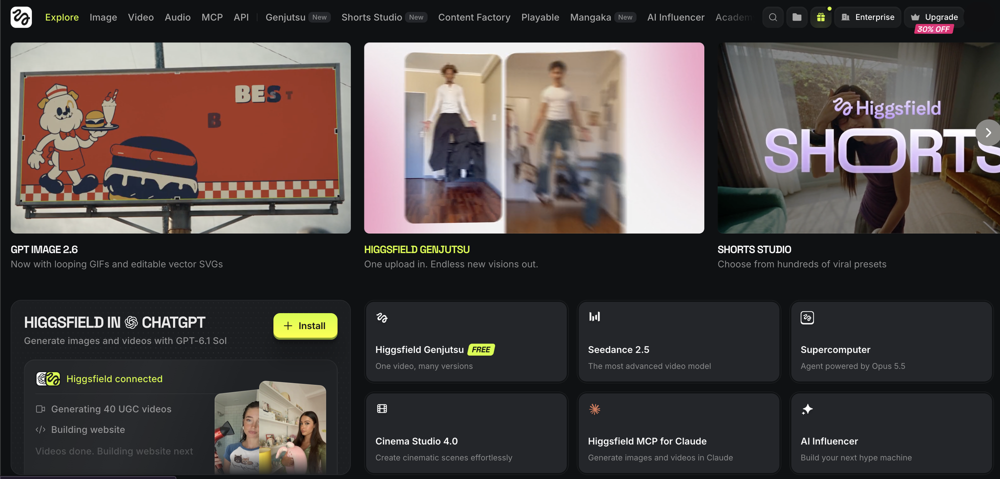

- **Cinema Studio 4.0** — Shoot a scene with a virtual camera, lens, lighting rig and colour palette.
- **Supercomputer** — Higgsfield's own chat agent, "powered by Opus 5.5": it plans a shoot and generates it.
- **Seedance 2.5 and friends** — Kling, Veo, Seedance and Genjutsu (free on the home page) under one credit balance.
- **MCP for Claude** — The connector that lets Claude Desktop drive all of it. You add it in Lab 1.

#### Pick the Model for the Job

Higgsfield offers many image and video models. Use a photoreal people model such as Soul 2.0 for character references, an all-rounder for props and places, a cheap model for drafts and a stronger one for finals; Claude can recommend them from models_explore.

The image model list on higgsfield.ai (8 Nov 2026). Claude reads the same roster with models_explore.

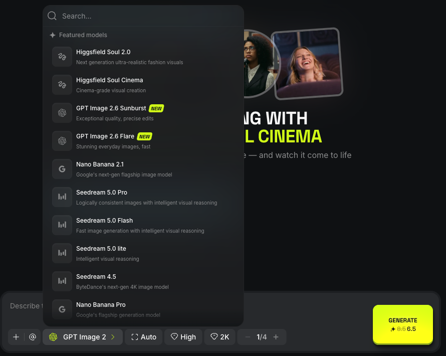

- **Higgsfield Soul 2.0** — Photoreal people for character references — 0.125 credits a still.
- **Nano Banana, GPT Image, Seedream** — Strong all-rounders for props, places and product shots.
- **Video models** — Seedance 2.0 Mini for cheap drafts with sound; Kling 3.0 Turbo or Seedance 2.5 for finals.
- **Let Claude choose** — "Recommend a draft model and a final model for a 9:16, 5-second shot."

#### Start Free: 3 Days and 100 Credits on Higgsfield

Sign up at higgsfield.ai?fpr=alfred-d0d32b, the trainer's affiliate link (the trainer may earn a commission; learners pay the normal price). The free 3-day Plus trial gives 100 credits, enough for about 40 Seedance 2.0 Mini drafts at 480p. It needs a card and renews to Plus unless cancelled within 3 days; saying "cancel auto-renewal" to Claude stops the charge. Higgsfield's MCP connector needs a paid plan or the trial, and the trial's credits work only through the Higgsfield MCP — exactly the route this course uses. On 8 November 2026 Plus cost $49 a month ($39 billed yearly) for 1,000 credits and Ultra $129 ($99 yearly) for 3,000. Generations made through Claude always spend credits, so set a budget in words before you start.

Sign up through the course link and the 3-day Plus trial gives you 100 credits — about 40 low-res drafts. Connect it to Claude in Lab 1.

**Download:** https://higgsfield.ai?fpr=alfred-d0d32b

- **Free 3-day Plus trial** — 100 credits · works through the Claude connector only
- **Plus — fits the course** — $49 a month ($39 billed yearly) · 1,000 credits
- **Ultra** — $129 a month ($99 billed yearly) · 3,000 credits
1. **Sign up** — Open the course sign-up link and create an account.
1. **Start the free trial** — A card is needed and the trial renews to Plus unless you cancel within 3 days: tell Claude "cancel auto-renewal".
1. **Connect Claude** — Customize > Connectors > Add custom connector > https://mcp.higgsfield.ai/mcp.
1. **Make a folder** — Higgsfield Assets > new folder, named after your Claude project.
1. **Set a budget** — Tell Claude: "Do not spend more than 80 credits. Ask before every batch."

Trainer's affiliate link: the trainer may earn a commission. Prices checked 8 Nov 2026.

#### Cast the Actors, Build the Set, Buy the Props: All Generated

Every production starts with references: a character sheet (front, back, portrait), a location plate and the key props. They are cheap, from 0.125 credits on Soul Cinema to 2-3 credits on Nano Banana Pro, GPT Image or Seedream 5.0 Pro, and they are reused in every shot, which is what keeps faces and objects from drifting.

Before a frame moves, Higgsfield's image models make your references. Cheap, fast, and reused in every shot.

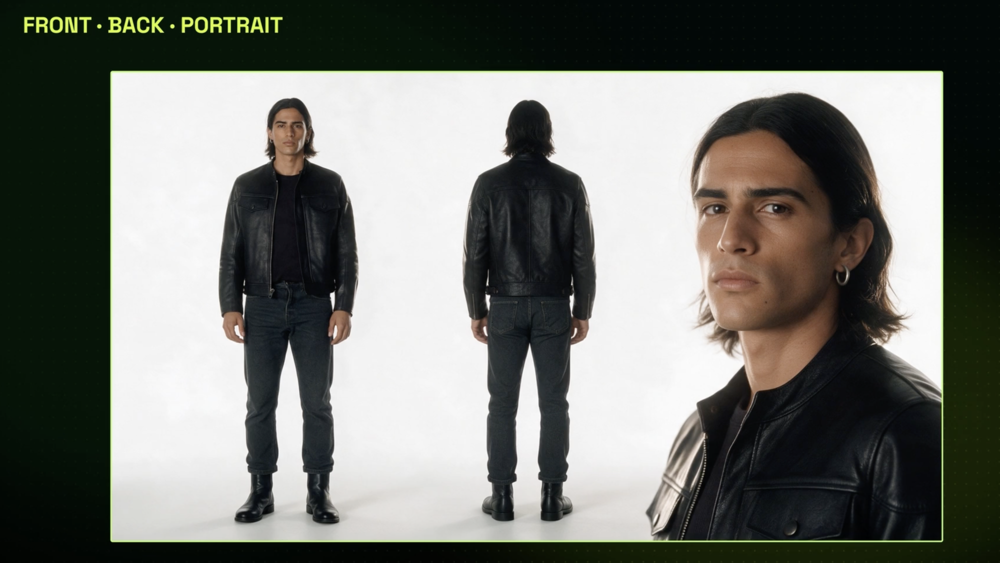
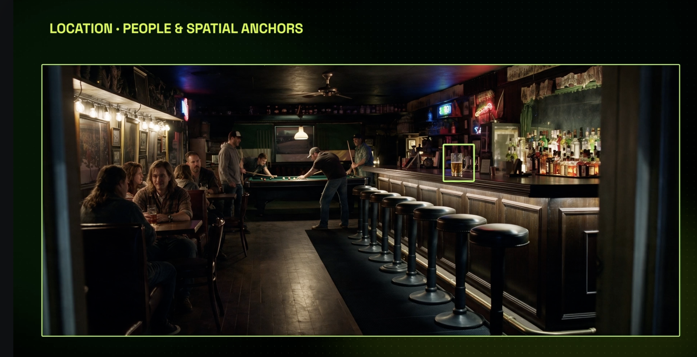
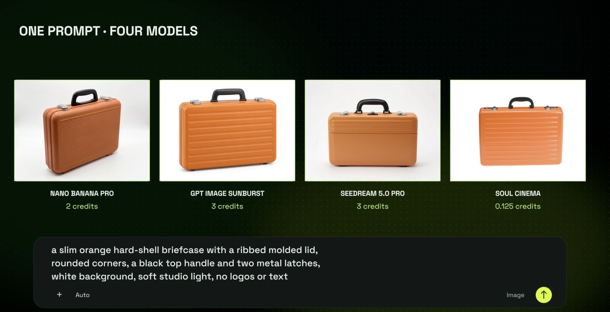

- **Character: front, back, portrait** — One sheet locks face, hair and costume from every side.
- **Location: a plate with anchors** — The bar, the lamps, the stools: the set every shot returns to.
- **Prop: one prompt, four models** — Soul Cinema 0.125 credits; Nano Banana Pro 2; GPT Image and Seedream 5.0 Pro 3.

Tip: Plain background, even light, no text, no logos: the four habits of a reference that works.

#### Generate a Reference Still in One Line

A reference still is one generation from the asset-bible prompt: front view, plain background, the fixed traits, 9:16. Check the cost on the Generate button first. On the free trial, generate through Claude.

The image generator: model, ratio, resolution, count — and the cost on the Generate button.

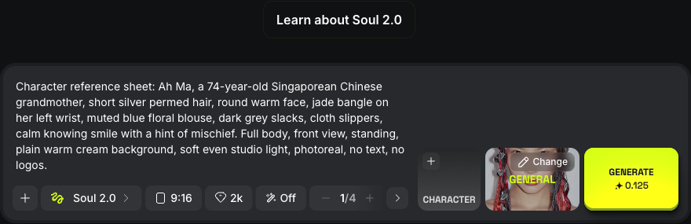

- **Paste the asset-bible prompt** — Front view, plain background, the five fixed traits.
- **Set 9:16 and one image** — Match the episode; one still is enough to pick from.
- **Read the cost first** — Soul 2.0: 0.125 credits a still. The trial generates through Claude only.
- **Or ask Claude** — The higgsfield-video skill calls generate_image with the same prompt.

#### Hold a Casting Call in 18 Seconds

Cinema Studio's AI Director takes a casting brief in plain words, loads the character-sheet skill, picks Higgsfield Soul 2.0 and returns five photoreal options in about 18 seconds. The learner chooses one, then makes single, specific edits ("add a silver wallet chain") on an editing model such as Seedream 5.0 Pro for about 3 credits. Fictional people only.

The AI Director writes the casting brief, picks the model and shows you five actors. You choose; then you change one thing.

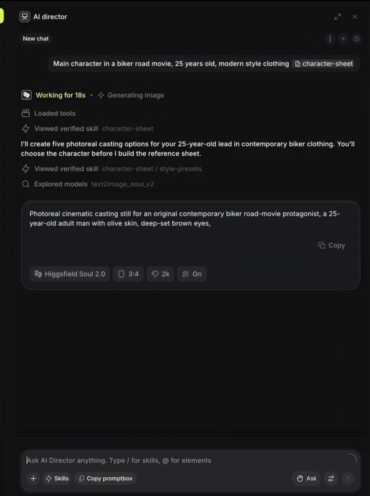
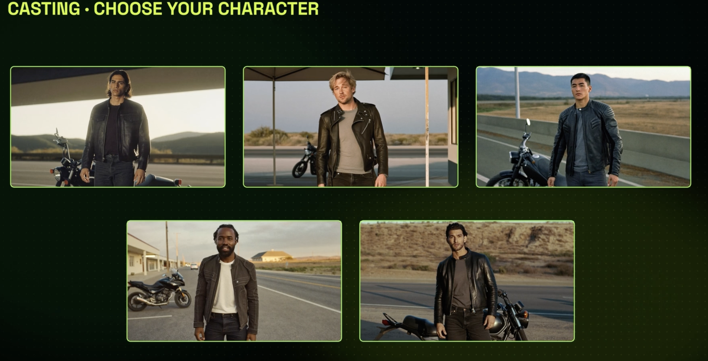
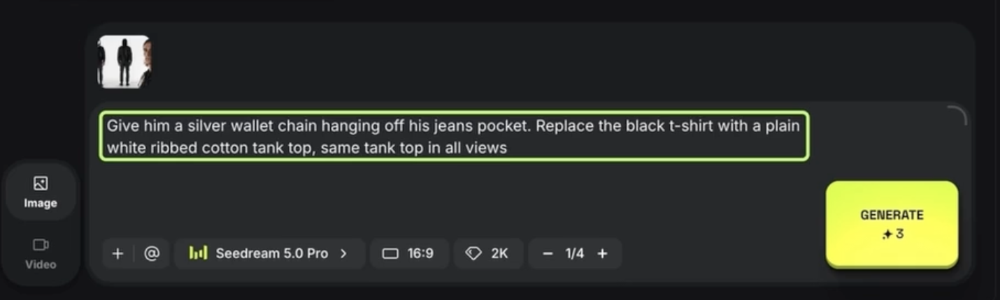

- **Ask** — "Main character in a biker road movie, 25 years old, modern style clothing" plus the character-sheet skill.
- **Choose** — Five photoreal options on Higgsfield Soul 2.0. The one you pick becomes the sheet.
- **Change one thing** — "Give him a silver wallet chain… same tank top in all views." Seedream 5.0 Pro, 3 credits.

#### Save It as an Element: the @Name You Prompt With

Saving a reference as an Element records its category, name, version, @handle, description, status and custom properties — the asset bible, kept in Higgsfield where every shot can reuse it.

Assets › Elements › Create element — the reference fields every shot reuses.

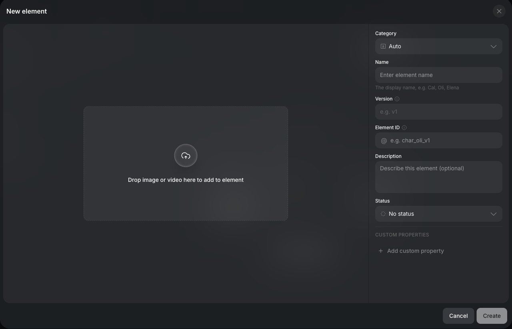

- **Category and Name** — Character, Location or Prop; "Ah Ma".
- **Version and Element ID** — v1 and @char_ahma_v1 — the handle you type in prompts.
- **Description and status** — The five fixed traits; mark it Approved.
- **Custom properties** — Age, outfit, accessories, series — the asset bible, stored in Higgsfield.

#### Your Reference Library: Assets › Elements

Higgsfield Elements store characters, locations and props once, with a name and an @handle. Mentioning an element in a prompt reuses the same reference, which keeps faces and props consistent across shots and projects.

higgsfield.ai › Assets › Elements — characters, locations and props saved once, used in every project.

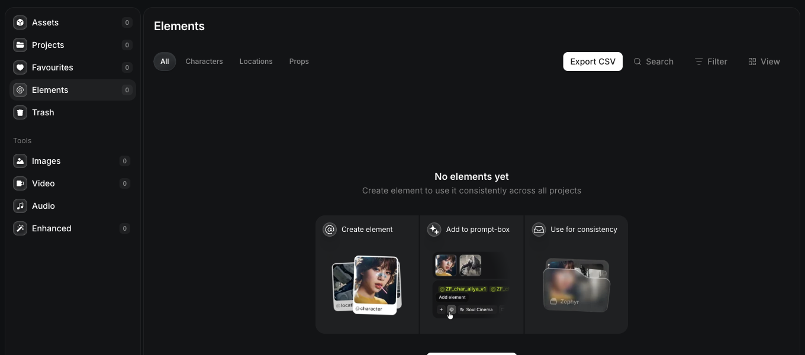

- **Characters, Locations, Props** — Three shelves: Ah Ma and Rachel; Ah Ma's HDB kitchen; props as you add them.
- **Add to the prompt box** — Type @ and pick the element — the shot uses that exact reference.
- **Use for consistency** — The same element in every shot keeps faces and props from drifting.
- **Export CSV** — Your asset bible, exported for the project folder.

#### Cinema Studio: Direct the Camera, Not Just the Words

Cinema Studio is Higgsfield's scene tool (versions 2.5 to 4.0; 3.5 added an AI director and style presets). Describe the scene, type @ to add up to 50 references, then set model, resolution, ratio, length, sound and number of takes. The Generate button shows the price before you click: 80 credits for a 5-second 1080p shot in the example.

higgsfield.ai › Cinema Studio. Describe the scene, drop in your references, set the shot, read the price.

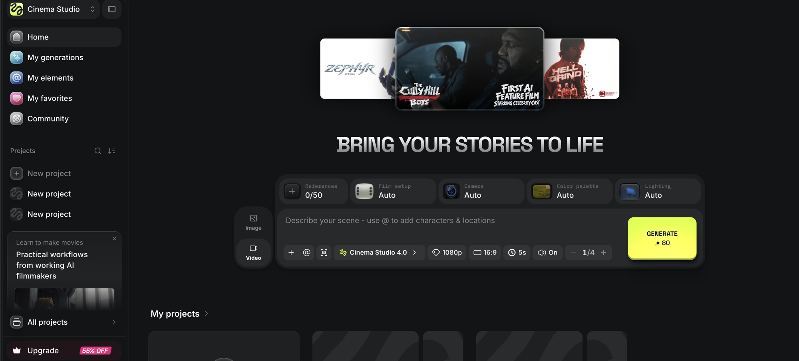

- **Tag your references** — Type @ to add characters and locations: up to 50 references in one scene.
- **Set the shot** — Cinema Studio 4.0, 1080p, 16:9, 5 s, sound on, one take.
- **Read the price** — The Generate button shows the cost before you click: 80 credits for this shot.
- **Four dials on top** — Film setup, camera, colour palette and lighting. Next slide.

#### Four Dials That Make a Clip Look Like Cinema

Above the prompt sit four panels: Film setup (genre, era, tempo), Camera (body, lens, aperture and movement), Lighting (presets such as Silhouette, Window and Practicals, or your own) and Colour palette (the grade). Left on Auto, the model guesses. Set them to match the storyboard and the look stays consistent from shot to shot.

Leave them on Auto and the model guesses. Set them and you are the director of photography.

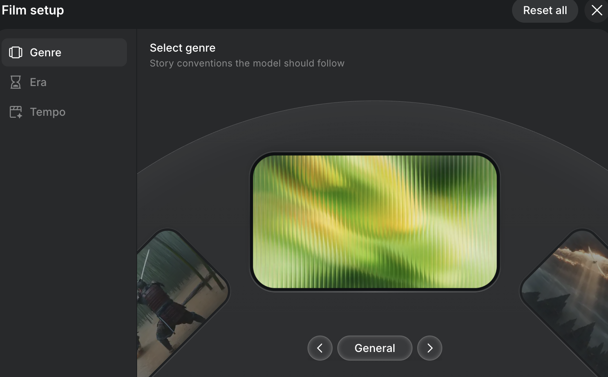
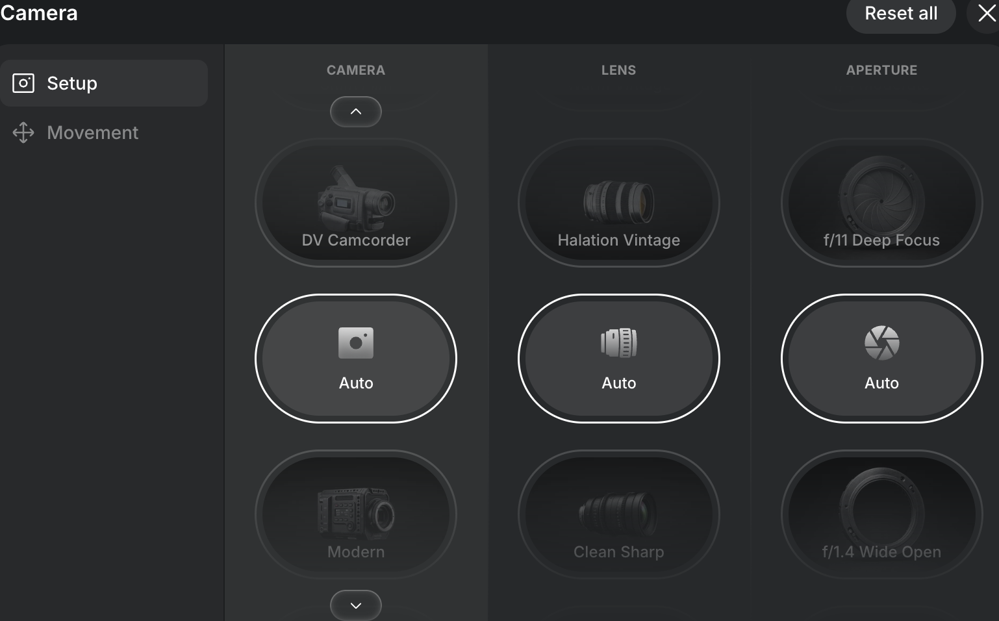
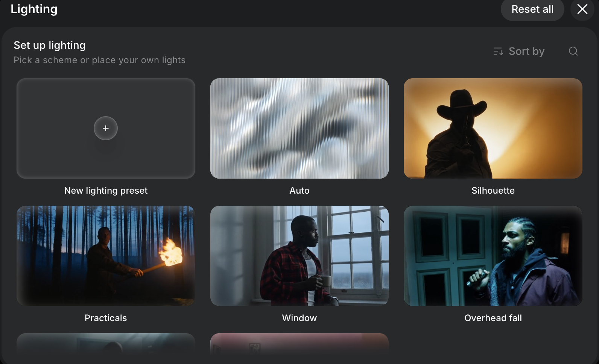
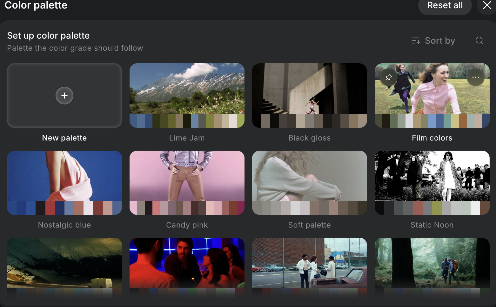

- **Film setup** — Genre, era and tempo: the story conventions the model follows.
- **Camera** — Body, lens, aperture: DV Camcorder, Halation Vintage, f/1.4 Wide Open.
- **Lighting** — Silhouette, window, practicals, overhead fall, or your own rig.
- **Colour palette** — Film colors, Nostalgic blue, Candy pink: the grade the shot follows.

#### Four Drafts at 480p, Then One Keeper at 1080p

Seedance 2.5 Draft renders the same prompt at 480p, up to four takes at once. Compare the takes for action, faces and props, keep one, then re-make only that one at 1080p with the same prompt and references. This is the course's low-res-first rule, done by hand.

Seedance 2.5 Draft makes cheap 480p takes of the same prompt. Re-make only the winner at full resolution.

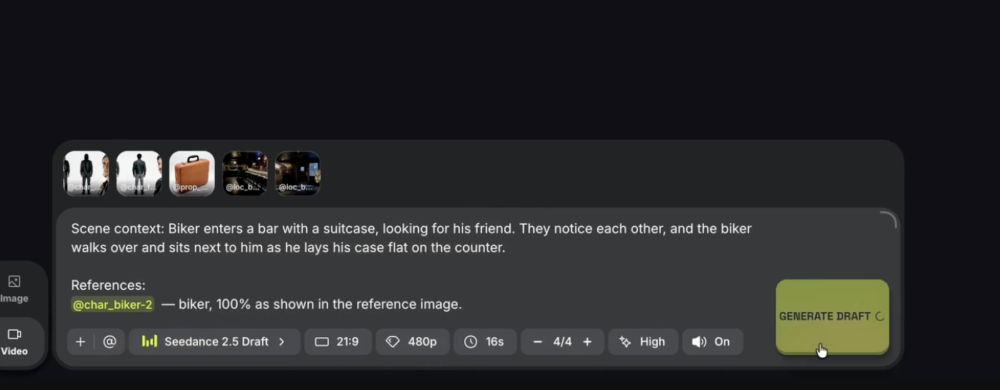
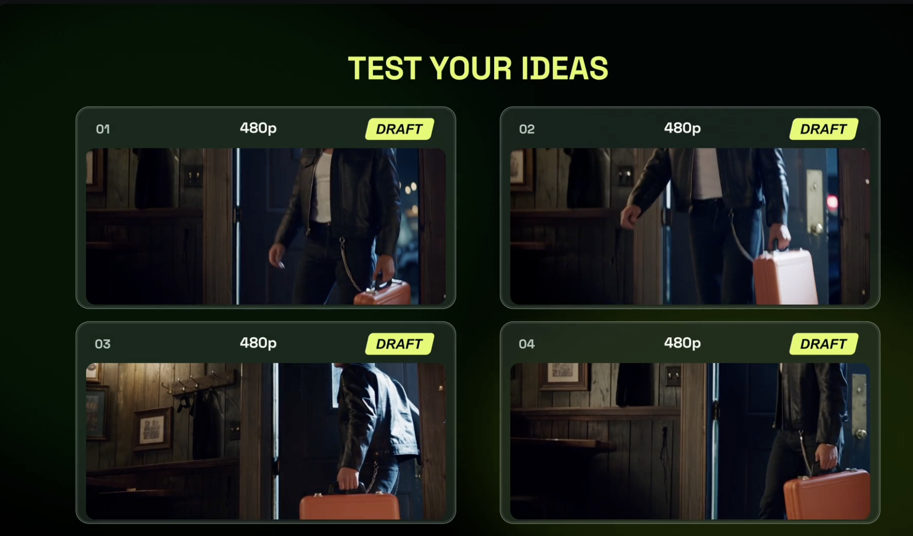
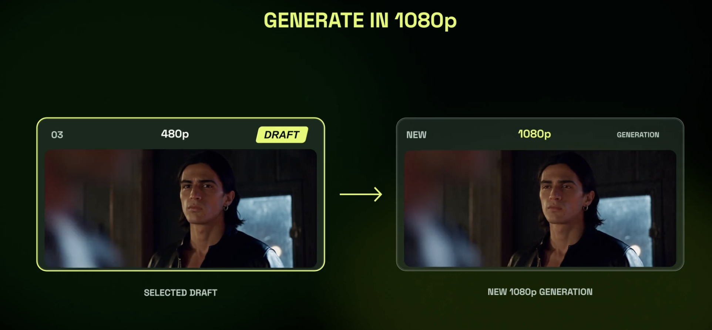

- **Prompt once, four takes** — Scene context plus @references. Seedance 2.5 Draft, 480p, 16 s, 4 takes.
- **Compare the takes** — Keep the one where the action, the faces and the suitcase all hold.
- **Upgrade the keeper** — Same prompt, same references, now at 1080p.

Tip: The course rule from Lab 4 on: no 1080p shot without an approved draft.

#### Supercomputer: Higgsfield's Own Agent Asks Before It Spends

Supercomputer is Higgsfield's built-in agent: a chat with projects, skills and connectors. Describe the job and it writes the settings, then shows an approval card with the price (240 credits for one 15-second 1080p Seedance 2.5 shot in the example). Tell learners to leave "Always allow" off: the approval is their budget gate.

A chat agent inside Higgsfield with projects, skills and connectors. It writes the shot, then waits for your yes.

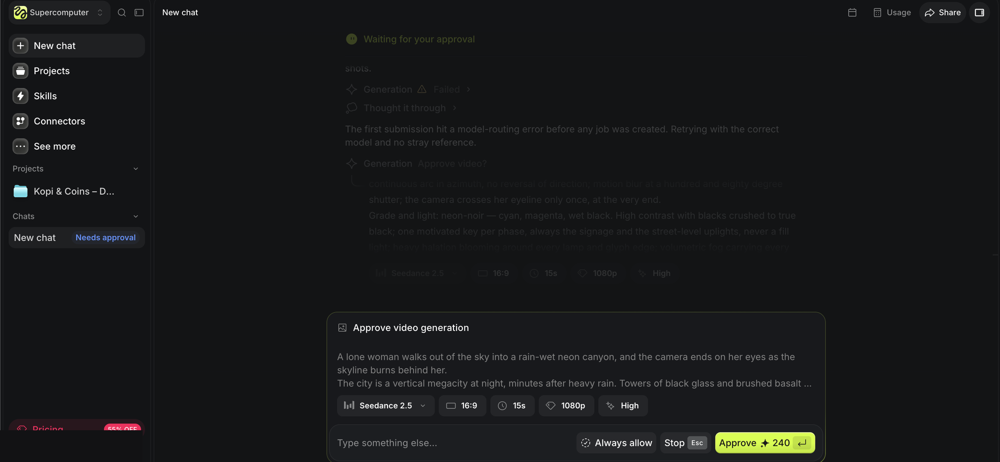

- **Describe the job** — "A lone woman walks out of the sky into a rain-wet neon canyon…"
- **It writes the settings** — Seedance 2.5, 16:9, 15 s, 1080p, high quality.
- **You approve the spend** — The card shows the price: 240 credits for this one shot.
- **Leave "Always allow" off** — Tick it and the agent stops asking. Keep the gate while you learn.

#### Slash a Skill: One Product Photo Becomes a Campaign

Supercomputer ships official skills (Katana, Visual Studio, Cinematic Director, Brand Asset Creation, Video Motion Graphics Editor and more). Type / to call one and @ to attach elements. The example scouts New York locations, runs /product-photoshoot for six vertical photos, then asks for a Cinema Studio commercial from the same images.

Supercomputer ships official skills. Type / to call one and @ to add your elements.

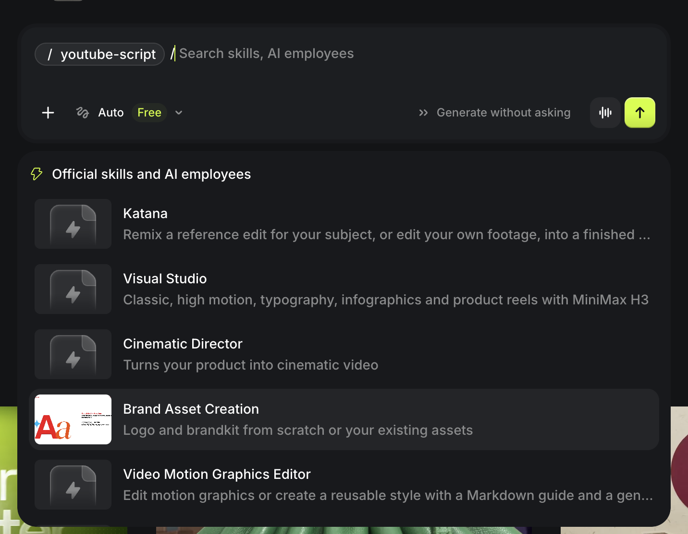
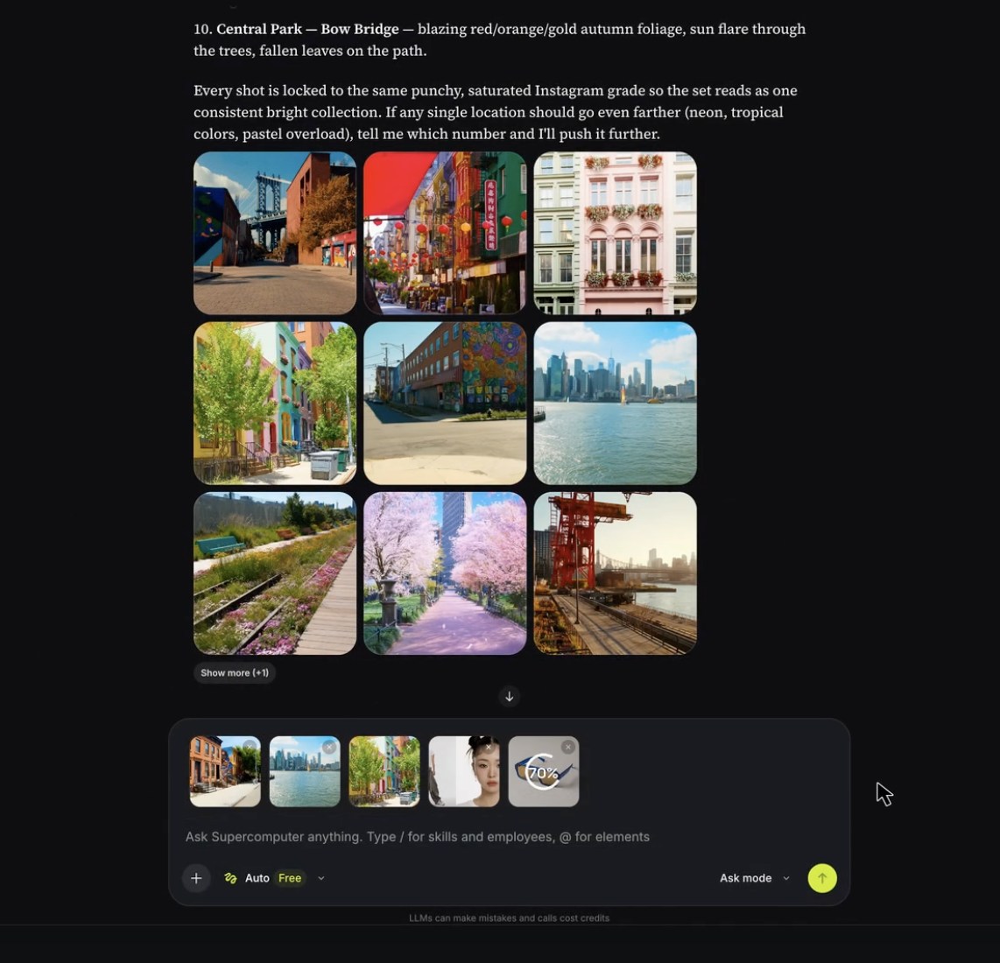
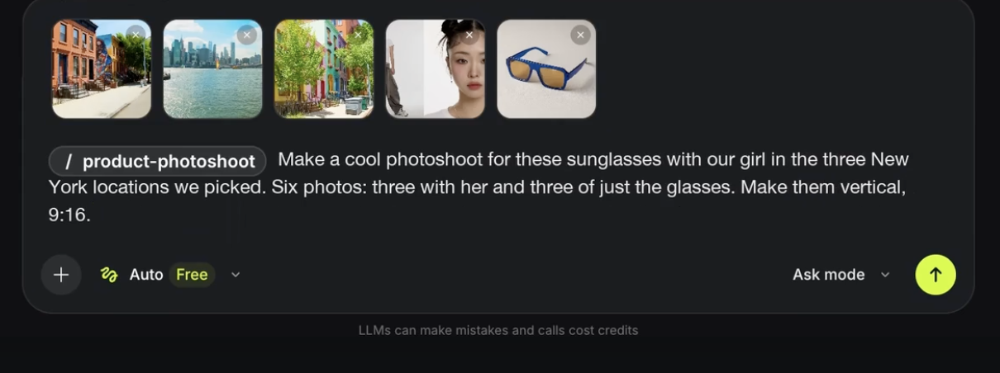

- **Pick a skill** — Katana, Visual Studio, Cinematic Director, Brand Asset Creation, Video Motion Graphics Editor.
- **Scout locations** — It proposes a grid of New York spots in one punchy grade. You pick three.
- **Shoot the campaign** — /product-photoshoot: "Six photos: three with her and three of just the glasses. 9:16."

Tip: One more line, "Generate a video in Cinema Studio using these images", and the stills become a commercial.

#### Go Deeper After Class: The Docs and a 25-Minute Walkthrough

Two references for self-study. The Higgsfield API docs (docs.higgsfield.ai/docs) list the models, parameters and endpoints, which helps when Claude reports a tool error. Metics Media's "Higgsfield AI Tutorial for Beginners (2026)" (YouTube, 30 Oct 2026, 24:36) walks through plans, the interface, images, image to video, consistency, multi-shot videos and 4K upscaling.

Two references for the evening you want to explore Higgsfield on your own.

- **Higgsfield API docs · docs.higgsfield.ai/docs** — The official reference for models, parameters and endpoints. Open it when Claude reports a tool error or a model name you do not know.
- **Metics Media · Higgsfield AI Tutorial for Beginners (2026)** — A 24:36 walkthrough on YouTube (30 Oct 2026): choosing a plan, the interface, images, image to video, consistent characters and products, multi-shot videos, 4K upscaling.
- **How to use them here** — Today you drive Higgsfield through Claude. The docs and the tutorial show what each button does when you work by hand.

#### The Video Production Lifecycle

AI does not remove the classic stages of production; it changes who does them and how fast. Skipping pre-production is the most common reason AI video looks random — there is no brief, no storyboard and no character reference for the model to follow.

AI changes who does each stage — not the stages themselves.

1. **Development** — Idea, audience, message, creative brief.
1. **Pre-production** — Script, storyboard, characters, references, standards, plan.
1. **Production** — Shoot — or generate — the shots, voice and music.
1. **Post-production** — Assemble, edit, sound, captions, colour, QC.
1. **Distribution** — Compliance check, approval, export, publish, measure.

Tip: Most AI-video failures are pre-production failures: no brief, no storyboard, no character references.

#### Four Decisions Before Anyone Writes a Line

Four decisions to make before anyone writes a line.

- **Logline** — The story in one sentence. "A young professional learns from her grandmother's biscuit tin why every payday starts with a rainy-day fund."
- **Audience** — Who exactly, on which platform, watching how. Young working adults, on a phone, sound often off.
- **One message** — What the viewer should remember. Pay your rainy-day fund first.
- **Tone and look** — Warm, hopeful, slice-of-life; soft natural light; a Singapore HDB home.

#### Story Structure for 60 Seconds

Short-form video compresses the three-act structure into about six beats. The hook must make the viewer feel the problem within five seconds; the payoff should mirror the hook so the change is obvious.

Short-form still needs a beginning, middle and end — compressed.

1. **Hook  0-5 s** — A problem the viewer feels at once: the laptop dies, the bank balance is $312.
1. **Set-up  5-15 s** — Who and where: Rachel calls Ah Ma.
1. **Turn  15-30 s** — The surprise: the tin is full of labelled envelopes.
1. **Choice  30-45 s** — The character acts: three savings buckets on payday.
1. **Payoff  45-55 s** — Six months later, the next shock is calm.
1. **End card  55-60 s** — The call to action and the disclaimer.

#### Writing a Short-Form Script

A script for the eye and the thumb, not the page.

- **Hook in 3 seconds** — Open on the problem, not the logo. If the first frame does not ask a question, viewers swipe.
- **Show, then tell** — Let the picture carry the story; voice-over adds only what the picture cannot.
- **Short lines** — About 2.5 spoken words a second — under 140 words for 60 seconds.
- **On-screen text** — The rule the viewer must remember appears as text: "Rule 1: rainy day first."
- **Sound cues** — Mark music changes and effects in the script; they carry emotion.
- **One call to action** — End with one thing to do, plus the disclaimer.

#### The Storyboard Is What the Model Actually Shoots

A storyboard breaks the script into shots. Each shot has one size, one angle, one movement and one action, plus a continuity line that says what must stay the same. This is also the right unit for an AI video model: one prompt per shot.

A storyboard turns the script into shots — the units an AI model actually generates.

- **One shot, one action** — Each frame shows a single action. Two actions in one prompt is where AI video falls apart.
- **Shot details** — Size, angle, movement, duration, characters, sound and on-screen text for every shot.
- **Continuity line** — What must stay the same as the previous shot: clothes, props, light, direction.
- **Cheap to change** — Moving a sketch costs nothing; regenerating a shot costs credits and time.

#### Pick the Shot Size by What the Viewer Must Feel

Choose the size by what the viewer needs to see — and feel.

| Shot | What it shows | Use it for |
|---|---|---|
| ECU — extreme close-up | An eye, a hand, a phone screen. | Detail and tension: the $1,400 repair quote. |
| CU — close-up | A face fills the frame. | Emotion: Rachel's reaction. |
| MCU — medium close-up | Head and shoulders. | Dialogue and video calls. |
| MS — medium shot | Waist up, some setting. | Action with context: setting up the savings buckets. |
| WS — wide shot | The whole person and the room. | Place and time: six months later. |
| EWS — extreme wide | A building, a city skyline. | Establishing shots and transitions. |

#### Camera Angles and Movement

Name them in every shot prompt — AI models follow camera language.

| Term | What it does | Example in Episode 1 |
|---|---|---|
| Eye level | Neutral; the viewer is an equal. | Most dialogue. |
| High / low angle | Makes a subject smaller / stronger. | Low angle on Ah Ma holding the tin. |
| Over-the-shoulder | Puts us in the conversation. | Rachel's phone screen during the call. |
| Static | Calm, observational. | The end card. |
| Push-in (dolly in) | Builds focus or tension. | Slowly onto the dead laptop. |
| Pan / tracking | Follows action or reveals space. | Following Rachel to the window. |

#### Characters and Consistency

Consistency comes from repeating concrete traits, not names. An asset bible lists five visible traits that never change; an approved reference still for each character lets Higgsfield animate every shot from the same face.

Viewers forgive a cheap set; they do not forgive a face that changes.

- **Character bible** — Identity, age, role in the story, how they move and speak — written once, reused for every episode.
- **Five fixed traits** — Face, hair, glasses, clothes, colours. Repeat them in every shot prompt.
- **Reference images** — A front-view still per character. In Higgsfield every shot animates from it.
- **Props are characters too** — The blue tin needs the same colour, dent and labels every time.

#### Composition for 9:16

Vertical video has its own rules — and the platform's buttons sit on top of your frame.

- **Rule of thirds** — Eyes on the upper third line; the subject on a third, not dead centre.
- **Safe zones** — Keep text out of the bottom ~20% and the right edge, where captions, likes and the caption bar sit.
- **Eyeline and 180-degree rule** — In a two-person scene, keep both on their side of an imaginary line so they face each other.
- **Screen direction** — If Rachel walks left to right in one shot, she keeps going left to right in the next.

#### Sound and Captions

Half the emotion is in the sound; most viewers start with it off.

- **Voice-over and dialogue** — Clear, close, never buried under music.
- **Music** — Sets the feeling; ducks under the voice; must be licensed or generated with rights.
- **Sound effects** — The laptop click, the tin lid — small sounds sell the moment.
- **Captions** — Always on for short-form; accurate, in sync, two lines at most, inside the safe zone.

#### Typing Prompts vs Directing a Production

You can type prompts into Higgsfield yourself, one clip at a time. With the connector, Claude turns an approved storyboard into every prompt, calls Higgsfield's tools, keeps a status table, holds the budget and writes the hand-off file for the editor — you direct and approve.

Higgsfield on its own, even with Supercomputer, makes great clips. Claude plus Higgsfield runs your whole production by your rules.

**Higgsfield on its own**

- You write or chat every shot in the web app.
- Your story, rules and approvals live in your head.
- Keeping Rachel's face the same is your problem.
- Nothing checks your budget or your storyboard.

**Claude + Higgsfield over MCP**

- The video-script skill writes every prompt from the approved board.
- Claude calls Higgsfield's tools and keeps a status table.
- References first: every shot animates from an approved still.
- A credit plan before, a hand-off file for the editor after.

#### Agentic AI vs AI Agents

The two terms are often used loosely. In this course: both use tool calling and skills, and both use memory. Agentic AI is task-oriented — it is given a task, works through it and stops, so it need not run 24/7. An AI agent is always on: it lives on a computer or server, keeps long-term memory and can be woken by a schedule, a message or another agent.

Both use the same building blocks. The difference is how long they live and what starts them.

**Agentic AI — task-oriented**

- Uses tool calling and skills to complete a task.
- Uses memory within the task (and often across sessions).
- Starts when you give it a task; stops when the task is done.
- Need not be on 24/7. Example: Claude making Episode 1 in Higgsfield.

**AI agents — always on**

- Also use tool calling and skills.
- Also use memory — long-term, about you and your work.
- Run 24/7 on a computer or server; wake on schedules and messages.
- Example: an always-on agent such as Hermes Agent running a weekly pipeline.

#### Agentic AI or an AI Agent? Pick by the Job

Use this table to decide what you need for a video job.

| Feature | Agentic AI | AI agents |
|---|---|---|
| Tool calling | Yes — generates images, video, voice, music. | Yes — plus files, browser, terminal, other apps. |
| Skills | Yes — Claude Skills: SKILL.md folders loaded on demand. | Yes — SKILL.md folders it can create and improve. |
| Memory | Yes — project history, references, elements. | Yes — long-term memory across every session. |
| Availability | Task-oriented; may not be on 24/7. | Always on, 24/7; reachable by chat apps. |
| Started by | You, with a task. | You, a schedule (cron), a message or another agent. |
| In this course | Labs 1-7 — Claude Desktop with skills and the Higgsfield connector. | Topic 3 — as the next step: schedules and always-on pipelines. |

#### Anatomy of a Single AI Agent

A language model on its own can only answer. An agent wraps the model with instructions, tools, skills, memory, context and guardrails so it can take actions and check them. Start every project with one agent; add more only when the work clearly splits into different jobs.

Start with one agent. A model on its own only answers; the parts around it let it act.

**The model** (the brain): Reads the goal, plans the next step and decides which part to use.

- **Instructions** — Who the agent is and the rules it follows — the studio brief, the project instructions.
- **Tools** — Actions it can take through connectors: Higgsfield's generate_image, generate_video_batch.
- **Skills** — Saved procedures it loads when the task matches — the storyboard skill.
- **Memory** — What it keeps: your preferences, past episodes, the character bible.
- **Context** — What it can see right now: attached files, the chat, the project state.
- **Guardrails** — Approvals, permissions and limits — what it must ask before doing.

One agent is enough when the work is one line of thought. Add agents only when the work splits into different jobs.

#### The Agentic Loop

The loop is goal, plan, act, observe, reflect — repeated until the goal is met or the agent needs approval. Your job is to give a clear goal and rules, and to review at the points where a mistake is expensive.

Every agent — chat, video or multi-agent — runs the same loop until the goal is met.

1. **Goal** — You state the outcome: "a 60-second episode on emergency funds".
1. **Plan** — The agent breaks it into steps: brief, script, storyboard, shots.
1. **Act** — It calls a tool or skill: write, generate, edit.
1. **Observe** — It reads the result: a script, a frame, a cut.
1. **Reflect** — It checks against the goal and your rules, then loops or stops for approval.

Tip: Give the goal and the rules, not micro-steps. Review at the points where a mistake is expensive.

#### Tools, Skills and Memory in a Video Agent

The three things that turn a chatbot into a production assistant.

- **Tools — what it can do** — Image models for characters and scenes, video models for motion, voice and music generation, captioning, the timeline editor, export.
- **Skills — how you want it done** — A saved workflow: "Kopi & Coins episode: 9:16, 60 s, warm light, captions on, disclaimer end card".
- **Memory — what it remembers** — The character bible, the brand, the last episode's fixes, your feedback style. Next episode starts ahead.

#### Which Agent for Which Job

Match the agent to the work. Bigger is not better.

| Agent | Best for | In this course |
|---|---|---|
| Claude + skills | Thinking work: briefs, scripts, storyboards, standards, plans. | Labs 1-3 (Claude Desktop project) |
| Claude + Higgsfield connector | Making the shots: stills, video, status, hand-off. | Lab 4 (Higgsfield over MCP) |
| An editor | Assembling, captioning, fixing and exporting the cut. | Lab 5 (LahLah Video or CapCut) |
| A skill chain with human gates | A repeatable, compliant pipeline from idea to upload. | Labs 6-7 (all skills + publish) |

Tip: Rule of thumb: one agent, many skills — add a tool only when the work needs it.

#### Skills, Connectors and Projects

Claude Desktop needs three things set up once. Skills are folders with a SKILL.md file that hold the studio's way of doing a job; Claude loads one when the task matches or when you name it. A connector is an MCP server Claude can call — Higgsfield's gives Claude tools to check credits, list models and presets, generate stills and video and wait for results. A project keeps one video's instructions, files and chats together; its twin is a Higgsfield folder with the same name.

Three things you set up once in Claude Desktop — then every lab is one prompt.

- **Skills — the studio's know-how** — Five ZIPs you upload once: storytelling, storyboard, video-script, higgsfield-video, platform-publish. Claude loads one when the task matches, or when you name it.
- **Connector — Higgsfield over MCP** — Customize > Connectors > Add custom connector, URL https://mcp.higgsfield.ai/mcp. Claude gets balance, models_explore, presets_show, generate_image, generate_video_batch, jobs_wait.
- **Project — one per video** — Instructions, the studio brief and every approved file, named 01-idea__ to 06-publish__. Its twin is a Higgsfield folder with the same name.

#### Idea to Upload: the Pipeline You Build

The course pipeline has seven stages: idea, story, storyboard, script, generation, edit and publish. Each has one skill or tool, and the gates — storyboard, script and budget approval, then upload approval — keep a person in charge of every credit spent and every post published.

Seven stages, one skill or tool each — and you approve before any credit is spent.

1. **Idea** — You, plus a Prompt Builder template.
1. **Story** — storytelling skill: brief, script, review.
1. **Storyboard** — storyboard skill: an artifact you approve.
1. **Script** — video-script skill: shots, assets, cinematic prompts.
1. **Generate** — higgsfield-video + Higgsfield: draft low-res, upgrade the keepers.
1. **Edit** — LahLah Video (default) or CapCut.
1. **Publish** — platform-publish: TikTok or YouTube, AI label on.

#### The Higgsfield Tools Claude Calls

The Higgsfield connector exposes tools Claude calls on your behalf: balance for credits, models_explore for today's models and costs, presets_show for camera presets, generate_image for reference stills, generate_video_batch for up to 12 shots at once, and jobs_wait for status and result links. Tool names come from the hosted server's catalogue; check the live list before each class.

One custom connector — https://mcp.higgsfield.ai/mcp — gives Claude these tools. You never type a tool name; the skills do.

| Tool | What it does | Used in |
|---|---|---|
| balance | Credits left and the current plan. | Labs 1, 4 |
| models_explore | Today's video and image models, with what each costs. | Labs 1, 4, 7 |
| presets_show | Camera presets by name, for each shot's move. | Labs 1, 4 |
| generate_image | Reference stills for characters, places and props. | Lab 4 |
| generate_video_batch | Up to 12 shots in parallel; returns job IDs. | Labs 4, 7 |
| jobs_wait | Status and result links for up to 12 jobs. | Labs 4, 5, 7 |

Tip: Names from the hosted server's catalogue, 8 Nov 2026. Before each class ask Claude: "List every Higgsfield tool you can call."

#### Install LahLah Video in One Line: Mac or Windows

LahLah Video is a free, open-source, CapCut-style editor. On a Mac, paste the curl command into Terminal; on Windows 10 or 11, paste the irm command into PowerShell. Each script downloads the newest release, installs it, clears the unknown-developer block and opens the app. To install by hand, download the .dmg (Mac) or -setup.exe (Windows) from the GitHub releases page; on first launch use Privacy & Security › Open Anyway (Mac) or More info › Run anyway (Windows). Lab 1 also has a prompt that asks Claude to run the right command for you.

Free, open source and CapCut-style. One command fetches the newest release, installs it and opens it.

**Mac**

Apple silicon or Intel. Open Terminal (Cmd+Space, type Terminal) and paste:

```
curl -fsSL https://raw.githubusercontent.com/alfredang/LahLahVideo/main/install/install.sh | bash
```

1. Installs into Applications and opens the app.
1. By hand: the .dmg from github.com/alfredang/LahLahVideo/releases, dragged into Applications.
1. "Apple could not verify LahLah Video"? System Settings › Privacy & Security › Open Anyway.

**Windows 10 or 11**

Open PowerShell (Start menu, type PowerShell) and paste:

```
irm https://raw.githubusercontent.com/alfredang/LahLahVideo/main/install/install.ps1 | iex
```

1. No admin password needed. The app opens when it finishes.
1. By hand: run the …_x64-setup.exe from the same releases page.
1. "Windows protected your PC"? Click More info › Run anyway.

Tip: Rather not type? Lab 1 has a prompt: Claude detects your system, shows you the one command, runs it and checks the window opens.

### Lab 1 — Set Up Your Claude Video Studio

**The story so far:** Priya has bought the studio a Claude plan and a Higgsfield plan. Before anyone writes a line, you set up the studio once: the skills that hold the studio's know-how, the connector that lets Claude drive Higgsfield, a project for Episode 1, and an editor on your laptop.

**Goal:** Install the tools once so every later lab is one prompt away: Claude calls the right skill and the right Higgsfield tool by name.

**You'll produce:** A Claude project "Kopi & Coins – Ep1 micro-drama (TikTok)" with five skills on, Higgsfield connected, the studio brief in its knowledge, and LahLah Video open on your computer

**Agent:** Claude Desktop — skills, the Higgsfield connector and a project  ·  **Time:** 30 min  ·  **Slides:** 57–62

**Lab folder:** labs/lab-01-set-up-your-claude-video-studio/ — assets/skills/storytelling.zip, assets/skills/storyboard.zip, assets/skills/video-script.zip, assets/skills/higgsfield-video.zip, assets/skills/platform-publish.zip, assets/project-ep01-setup.pdf, assets/studio-brief.pdf, assets/setup-checklist.pdf

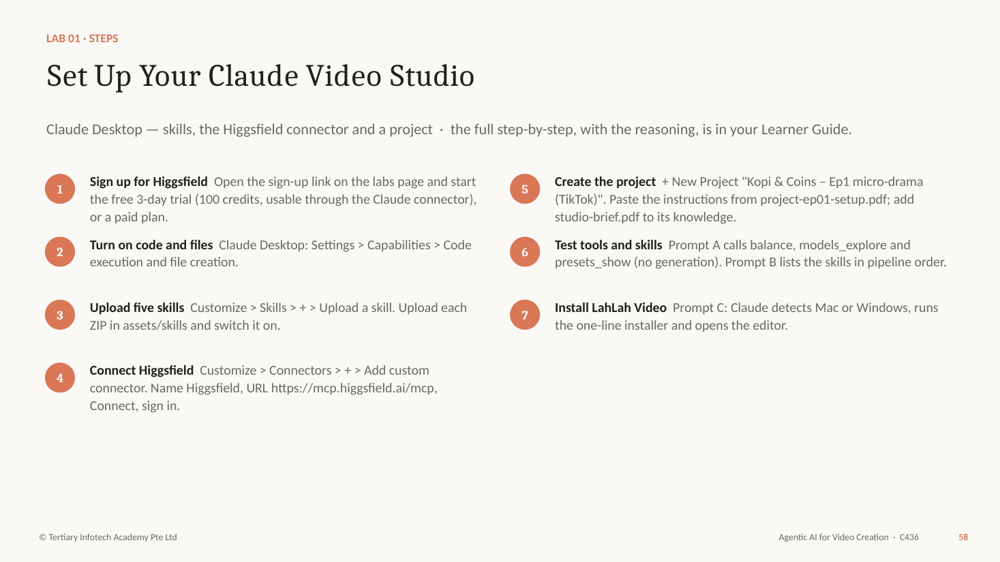

Figure — Lab 1 workflow (slide 58)

**Why each step matters**

- A skill is a folder with a SKILL.md file: the studio's way of doing one job, written once. Claude loads it only when the task matches, or when you name it — "use the storyboard skill". Five skills cover the whole pipeline: storytelling, storyboard, video-script, higgsfield-video and platform-publish.
- A connector is an MCP server Claude can call. Higgsfield's connector gives Claude tools such as balance (credits left), models_explore (which video models exist today), presets_show (camera presets), generate_image, generate_video_batch and jobs_wait (status and result links). Every MCP generation spends Higgsfield credits, even on "unlimited" plans.
- A project keeps one video's instructions, files and chats together. Project knowledge has no folders, so the studio uses filename prefixes instead: 01-idea__, 02-storyboard__, 03-script__, 04-assets__, 05-edit__, 06-publish__.
- The Higgsfield side mirrors the project: a folder in Higgsfield Assets with the same name. Every reference still and every clip for Episode 1 is moved into it, so nothing lives outside Higgsfield and anyone can trace a shot to its job.
- Claude is already on your laptop, so let Claude install the editor. The install script picks the right .dmg or .exe, copies it and clears the macOS download warning — no hunting through download pages.

**Step-by-step**

1. **Sign up for Higgsfield** — Open the sign-up link on the labs page and start the free 3-day trial (100 credits, usable through the Claude connector), or a paid plan.
1. **Turn on code and files** — Claude Desktop: Settings > Capabilities > Code execution and file creation.
1. **Upload five skills** — Customize > Skills > + > Upload a skill. Upload each ZIP in assets/skills and switch it on.
1. **Connect Higgsfield** — Customize > Connectors > + > Add custom connector. Name Higgsfield, URL https://mcp.higgsfield.ai/mcp, Connect, sign in.
1. **Create the project** — + New Project "Kopi & Coins – Ep1 micro-drama (TikTok)". Paste the instructions from project-ep01-setup.pdf; add studio-brief.pdf to its knowledge.
1. **Test tools and skills** — Prompt A calls balance, models_explore and presets_show (no generation). Prompt B lists the skills in pipeline order.
1. **Install LahLah Video** — Prompt C: Claude detects Mac or Windows, runs the one-line installer and opens the editor.

**PROMPT A — test the Higgsfield tools (no generation)**

> Check the Higgsfield connector without generating anything.

> 1. Call balance and tell me my credits and plan.
> 2. Call models_explore and recommend two video models for a 9:16, 5-second image-to-video shot: one cheap low-res draft model and one final-quality model, with the credit cost of each at 480p or 720p and at 1080p.
> 3. Call presets_show and list ten camera presets by name.

> List every Higgsfield tool you can call, one line each. Do not call any generate_ tool.

**PROMPT B — test the skills**

> List the skills you can use in this project. For each one give:
> its name, the job it does, the words in my request that would make you load it, and what it hands to the next skill.

> Then tell me the order the five video skills run in for one episode, from idea to publish.

**PROMPT C — install LahLah Video with Claude**

> Install LahLah Video on this computer. Detect whether I am on macOS or Windows. On macOS run: curl -fsSL https://raw.githubusercontent.com/alfredang/LahLahVideo/main/install/install.sh | bash . On Windows run in PowerShell: irm https://raw.githubusercontent.com/alfredang/LahLahVideo/main/install/install.ps1 | iex . Show me each command before you run it, then confirm that LahLah Video opens.

**Check your work**

- ☐  Five skills appear under Customize > Skills and are switched on.
- ☐  Higgsfield shows as connected, and Prompt A returned a real credit balance from the balance tool.
- ☐  Claude named a low-res draft model and a final model from models_explore, with costs, and ten presets from presets_show.
- ☐  The project exists with its instructions saved and studio-brief.pdf in its knowledge.
- ☐  Claude listed the five skills in pipeline order.
- ☐  LahLah Video opens on your computer.

**If it goes wrong**

- **Claude answers without calling a tool** — In the chat, open + > Connectors and switch Higgsfield on. If it still fails, Disconnect and Connect again.
- **"Authorization with the MCP server failed"** — The sign-in expired. Disconnect the Higgsfield connector, Connect, sign in again.
- **A skill upload is rejected** — Upload the ZIP as shipped; it holds one folder named exactly like the skill.
- **macOS says the app cannot be opened** — Run Prompt C again so the installer clears the quarantine flag, or right-click the app and choose Open.

**Stretch**

- Ask Claude: "Which Higgsfield tools could spend credits or post publicly?" Add a rule to the project instructions that Claude must ask before calling any of them.

Set up once, then speak in jobs, not steps: "use the storyboard skill on the approved script" beats twenty lines of instructions.

### Key ideas for Lab 2

#### One Prompt, and Claude Casts the Actors and Builds the Set

With the connector on, one prompt makes the references. Claude uses the higgsfield-video skill, quotes the credits, calls generate_image on Soul 2.0 for each still, waits for your approval and saves the keepers as Elements with @handles. The same handles then go into every shot prompt.

The prompt behind the Ah Ma demo's references. Claude prices it, calls Higgsfield and files every still.

**PROMPT — references through the Higgsfield connector**

```
Use the higgsfield-video skill. From the approved asset bible,
make three 9:16 reference stills on Soul 2.0, one image each:
1. Ah Ma, 74: silver perm, jade bangle on her left wrist, muted
   blue floral blouse, knowing smile. Front view, plain cream
   background, photoreal, no text, no logos.
2. Rachel Tan, 29: shoulder-length black hair, round tortoiseshell
   glasses, mustard cardigan over a white tee. Same set-up.
3. Ah Ma's HDB kitchen: round marble table, two kopi cups, a money
   plant on the sill, afternoon sun, no people.
Quote the credits first. Save each still I approve as an Element:
@char_ahma_v1, @char_rachel_v1, @loc_hdb_kitchen_v1.
```

#### Three Keepers for Under Half a Credit

The demo's references: Ah Ma, Rachel and Ah Ma's HDB kitchen, each a Soul 2.0 still at about 0.125 credits. The first kitchen showed garbled text on a tin (a typical AI quality issue), so Claude re-rolled it without the tin. All three were saved as Elements and used in every shot.

What came back: Soul 2.0 stills at 0.125 credits each, saved as Elements and reused in all four shots of the demo.


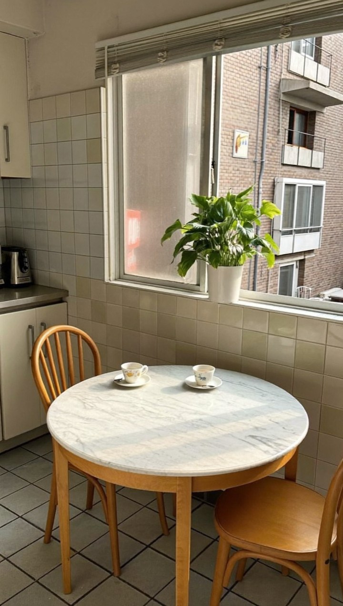

- **@char_ahma_v1** — Jade bangle, blue floral blouse, and a smile that knows more than it says.
- **@char_rachel_v1** — Round glasses, mustard cardigan: the fixed traits every shot repeats.
- **@loc_hdb_kitchen_v1** — Take two. Take one had garbled text on a tin, so Claude re-rolled it without the tin.

#### Ah Ma's Love Letter: 23 Seconds of Film for 14 Credits

The course demo, made on 8 Nov 2026 with the course prompts. Four shots on Seedance 2.0 Mini at 480p (2.5 credits each; one 6-second shot) with lip-synced dialogue, three stills and a 22-second ElevenLabs music bed: about 14 credits in all. Cut in LahLah Video at 24 fps with captions, an end card and the AI label. The video is embedded, so it plays offline.

The whole course in one short film. Claude wrote and boarded it, Higgsfield shot it, LahLah Video cut it.

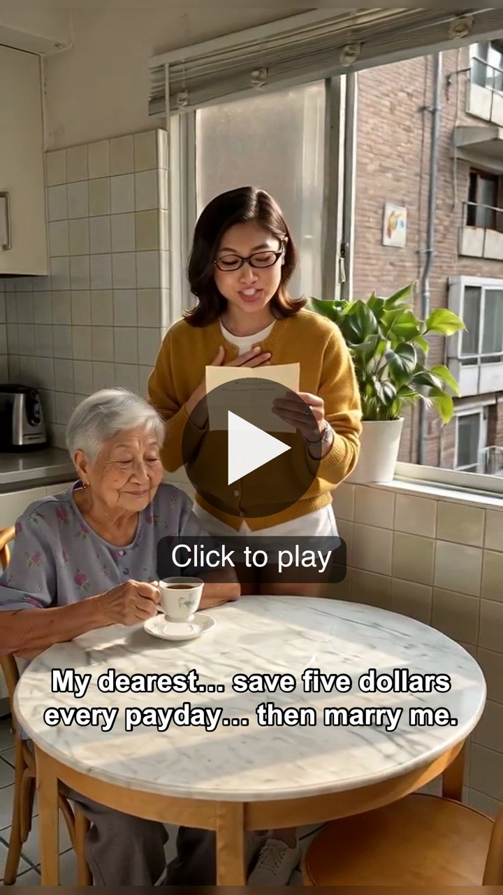

- **The story** — Rachel finds a 1972 letter in Ah Ma's blue tin and reads it aloud, expecting romance. It is a proposal with a savings plan.
- **Four shots, lip-synced** — Seedance 2.0 Mini at 480p: 2.5 credits a shot, dialogue and sound generated with the picture.
- **Music and the cut** — A 22-second ElevenLabs music bed (3.2 credits), cut at 24 fps with captions, an end card and the AI label.
- **The punchline** — Ah Ma: "That's why got this tin lah." Love is… saving first.

AI-generated video, fictional characters. Made 8 Nov 2026. Click the video to play.

#### How the Demo Was Cut: Four Clips, Three Captions, One Music Bed

The demo open in LahLah Video. Claude's hand-off file (lahlah-edit.json) placed the four Higgsfield clips on the main track, the title and three captions above them and the music bed below, with ducking under the voices. The project runs at 24 fps to match the clips: a 30 fps project repeats frames and the motion judders. Ask LahLah (bottom right) takes the next edit by voice or text.

The same film open in LahLah Video. Claude built this timeline from one hand-off file; you only press Play and Export.

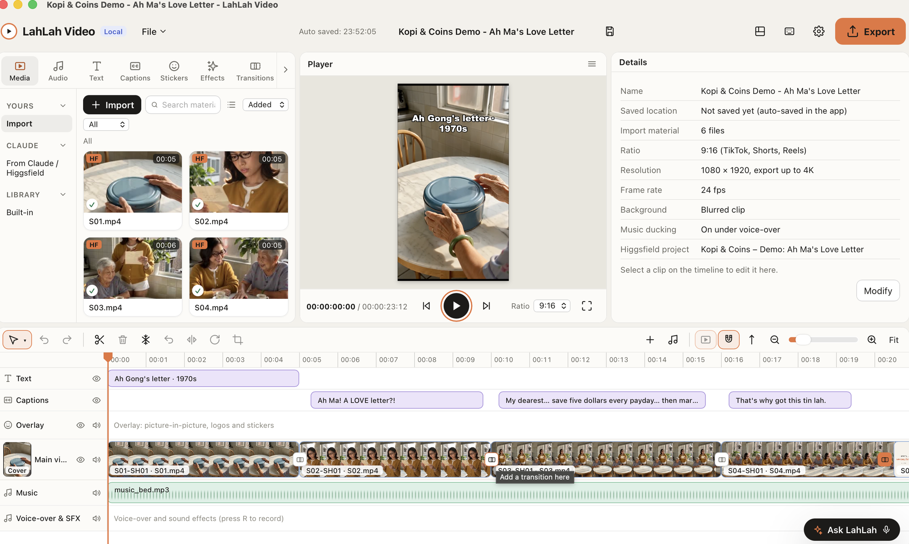

- **From Claude / Higgsfield** — S01-S04 arrive in the media bin tagged HF, straight from the Higgsfield project.
- **Read the tracks** — Text, captions, overlay, main video, music, voice-over: top to bottom, like CapCut.
- **Details that matter** — 9:16, 1080 x 1920, 24 fps to match the clips, music ducking on under the voices.
- **Ask LahLah** — Bottom right: say or type the next edit. Export sits top right.

#### Types of Quality Issues in Video Content

Quality issues fall into five types: technical picture problems, technical sound problems, issues typical of AI generation, story and continuity problems, and compliance problems. Knowing the type tells you how to spot the issue and which kind of solution will fix it.

Know what can go wrong so you can design it out — and spot it in review.

| Type | Examples | How you notice |
|---|---|---|
| Technical — picture | Low resolution, blur, flicker, compression blocks, wrong aspect ratio, black frames. | Full-screen playback on the target device; check export settings. |
| Technical — sound | Clipping, noise, music over voice, uneven loudness, out-of-sync audio. | Headphones; a loudness meter. |
| AI generation | Face drift, extra fingers, warped objects, garbled text, impossible physics, uncanny lip-sync. | Frame-by-frame checks against references. |
| Story and continuity | Weak hook, unclear message, slow pacing, props or clothes that change, jump cuts. | Watch as a viewer; compare adjacent shots. |
| Compliance | Unlicensed music, missing disclaimer, misleading claims, personal data, unlabelled AI content. | Check against standards and a checklist. |

#### Quality Issues Typical of AI Video

Generative video fails in recognisable ways. Name them so you can prompt against them.

- **Identity drift** — The face, hair or glasses change between shots.
- **Anatomy and objects** — Extra fingers, melting hands, a phone that bends.
- **Garbled text** — Signs, screens and labels become nonsense letters.
- **Physics and motion** — Objects pass through each other; walking slides; flicker between frames.
- **Lip-sync and voice** — Mouths out of time; voice that does not fit the character.
- **Style drift** — Lighting, colour or art style changes mid-episode.

#### Edit Types and When to Use Them

Reviewing a script means deciding, scene by scene, which edits will create the intended feeling. A match cut links two ideas, a montage compresses time, a J-cut or L-cut lets sound lead or trail the picture, and a text overlay fixes the key idea in the viewer's memory.

Reviewing a script means deciding which edits will deliver the creative vision.

| Edit | What it does | Episode 1 example |
|---|---|---|
| Cut / jump cut | Moves on instantly; a jump cut compresses time. | Laptop dies → bank balance. |
| Cutaway / B-roll | Shows detail that supports the voice. | The labelled envelopes inside the tin. |
| Match cut | Links two shots by shape or action. | The tin lid closing → the banking app opening. |
| Montage | Compresses time in a rhythm of short shots. | Three paydays in three seconds. |
| J-cut / L-cut | Sound leads or trails the picture. | Ah Ma's voice starts before we see her. |
| Text overlay | Puts the key idea on screen. | "Rule 1: rainy day first." |

#### Reviewing a Script for Edits

A procedure you can run on any script — with or without an agent.

1. **Find the vision** — Re-read the brief: audience, one message, tone.
1. **Mark the beats** — Split the script into hook, set-up, turn, choice, payoff, end card.
1. **Name the feeling** — For each beat, what should the viewer feel?
1. **Choose the edits** — Pick the edit types that create that feeling (cut, match cut, montage, J/L-cut, text).
1. **Flag the risks** — Note the quality issues each scene invites.
1. **Decide** — Accept, change or reject — and record why.

Tip: The agent can draft the review; the producer owns the decisions.

### Lab 2 — Plan the Story with Claude and the Storytelling Skill

**The story so far:** Priya wants Episode 1, The Rainy-Day Tin, live in two weeks. Before anyone spends a Higgsfield credit, the story has to work on paper — and you need to know which edits and which quality risks each scene will bring.

**Goal:** Use one AI agent and one skill to turn an idea into a brief and a timed script, then review the script to decide the edits each scene needs.

**You'll produce:** 01-idea__brief, 01-idea__script-v1 and 01-idea__script-review saved to the project knowledge

**Agent:** Claude Desktop — the storytelling skill  ·  **Time:** 50 min  ·  **Slides:** 71–77

**Lab folder:** labs/lab-02-plan-the-story-with-claude/ — assets/episode-01-idea.pdf, assets/script-review-template.pdf, assets/sample/script-v1.pdf, assets/sample/script-review.pdf

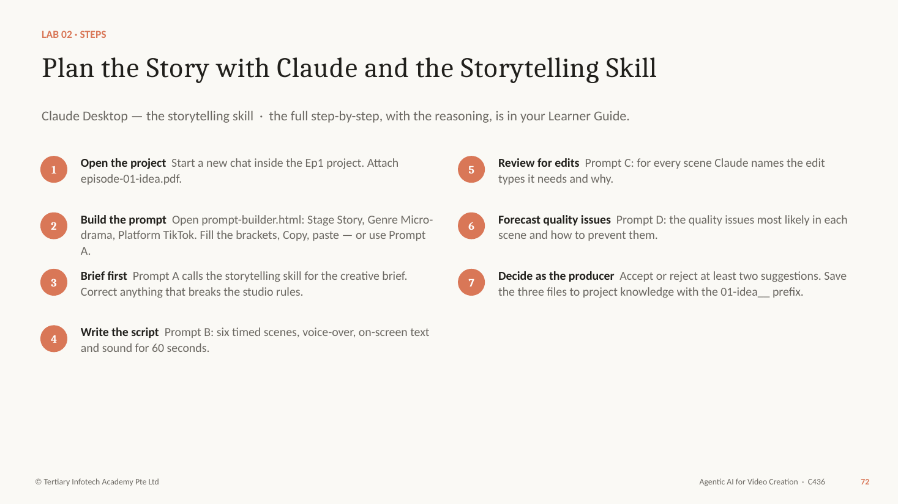

Figure — Lab 2 workflow (slide 72)

**Why each step matters**

- One agent is enough here. Planning is a single line of thought — brief, script, review — and the storytelling skill gives Claude the studio's structure for a micro-drama: hook in three seconds, set-up, turn, choice, payoff, end card.
- The Prompt Builder holds a template for every stage, genre and platform. You change the words in [BRACKETS]; the structure that makes the prompt work stays put.
- The brief comes before the script because it fixes the audience, the one message and the rules. A script written without a brief drifts into generic money tips.
- The script review is the skill at work here: reading a script and deciding which edits will deliver the creative vision — a match cut between the tin and the banking app, a montage for "six months later", a text overlay for the rule.
- Your decision step matters. Claude proposes; the producer decides. Record why you rejected a suggestion — that note is evidence of judgement.

**Step-by-step**

1. **Open the project** — Start a new chat inside the Ep1 project. Attach episode-01-idea.pdf.
1. **Build the prompt** — Open prompt-builder.html: Stage Story, Genre Micro-drama, Platform TikTok. Fill the brackets, Copy, paste — or use Prompt A.
1. **Brief first** — Prompt A calls the storytelling skill for the creative brief. Correct anything that breaks the studio rules.
1. **Write the script** — Prompt B: six timed scenes, voice-over, on-screen text and sound for 60 seconds.
1. **Review for edits** — Prompt C: for every scene Claude names the edit types it needs and why.
1. **Forecast quality issues** — Prompt D: the quality issues most likely in each scene and how to prevent them.
1. **Decide as the producer** — Accept or reject at least two suggestions. Save the three files to project knowledge with the 01-idea__ prefix.

**PROMPT A — creative brief (storytelling skill)**

> Use the storytelling skill. Read the studio brief in this project and the attached episode idea.

> Write a one-page creative brief for Episode 1, "The Rainy-Day Tin": audience, the one message, platform and format (TikTok, 9:16, 60 seconds), tone, logline, characters, call to action, must include, must avoid.

> Rules: general money education only. No product names, no promised returns, no numbers we cannot source. Ask me up to three questions before you write if anything is unclear.

**PROMPT B — the 60-second script**

> Using the approved brief, write the script for Episode 1.

> Six scenes, timed to exactly 60 seconds:
> hook (0-5s), set-up, turn, choice, payoff, end card (55-60s).

> For each scene give: time range, what we SEE, voice-over or dialogue, on-screen text, and sound (music cue or effect). Keep spoken lines short — under 140 words in total. End card: "Start your rainy-day tin this payday." plus the disclaimer from the studio brief.

**PROMPT C — script review for edits**

> Review script-v1 as a video editor before production.

> Make a table, one row per scene: scene, what the scene must make the viewer feel, the edit types it needs (for example cut, cutaway or B-roll, match cut, montage, J or L cut, text overlay, speed ramp, transition, music cue), and why each edit serves the story.

> Then list two scenes where a different edit would be stronger, and say what you would change.

**PROMPT D — quality-issue forecast**

> For the same six scenes, forecast the quality issues we are most likely to meet when Higgsfield generates this episode.

> Group them as: technical (picture and sound), AI generation (for example face drift, extra fingers, garbled text), story and continuity, and compliance (music rights, disclaimer, misleading money claims).

> For each issue give the scene, how we would notice it, and one way to prevent it in the prompt or the edit.

**Check your work**

- ☐  The brief names one audience, one message and the must-avoid rules.
- ☐  The script has six scenes that add up to exactly 60 seconds.
- ☐  The end card carries the call to action and the disclaimer.
- ☐  The script review lists the edit types for every scene, with a reason for each.
- ☐  The quality forecast covers all four groups of issues.
- ☐  You accepted or rejected at least two suggestions and wrote why.

**If it goes wrong**

- **Claude invents statistics** — Reply: "Remove every number you cannot source. Use general wording instead."
- **The script runs long** — Ask for a word count per scene and a 140-word cap; spoken English runs about 2.5 words a second.

**Stretch**

- Ask Claude for a 30-second cut-down of the same script and compare which scenes survive.

The cheapest place to fix a video is the script. Every edit you decide now is a Higgsfield credit you will not spend later.

### Key ideas for Lab 3

#### Editing Standards and Guidelines

Editing standards are the written rules every episode must meet. Writing them down makes them checkable by a reviewer — and usable by an AI agent as a skill. Each rule should have a number or a yes/no test.

The written rules every episode — and every agent — must meet before publishing.

- **Brand** — Colours, fonts, logo position, the end card.
- **Story** — Hook in 3 seconds, one message, pacing limits.
- **Captions** — Always on, accurate, two lines max, in the safe zone.
- **Audio** — Voice clarity, music under voice, loudness target.
- **Legal** — Rights, personal data, money messaging, AI labelling.
- **Platform** — 9:16, 1080x1920, frame rate, duration limits.

#### Legal Requirements for Video in Singapore

A studio publishing money education in Singapore must respect copyright, personal data protection, the line between general education and regulated financial advice, advertising standards, and platform rules on AI-generated content. This table is general guidance for the course scenario, not legal advice.

What the studio's guidelines must protect against. General guidance — not legal advice.

| Area | Requirement | Guideline for Kopi & Coins |
|---|---|---|
| Copyright | Copyright Act 2021: music, images and footage need permission or a licence. | Use licensed or rights-cleared generated music; record the licence. |
| Personal data | PDPA: do not collect, use or show personal data without consent. | Fictional characters only; no real bank screens or names. |
| Money messaging | Financial Advisers Act: recommending specific products is regulated advice. | General education only; no products, no promised returns; disclaimer. |
| Advertising | Singapore Code of Advertising Practice (ASAS): truthful, not misleading; disclose sponsorship. | No exaggerated claims; label any sponsored episode. |
| AI content | Platforms require labels for realistic altered or synthetic content. | Turn on the AI-content disclosure when uploading. |

#### Broadcasting and Platform Standards

Broadcast loudness is set by EBU R128 (-23 LUFS) in Europe and ATSC A/85 (-24 LKFS) in the US; streaming platforms normalise playback to roughly -14 LUFS. Picture, captions and framing have their own standards. Quote them with numbers in your guidelines.

Technical rules your guidelines should quote with numbers.

| Standard | Requirement | For a 60 s Short |
|---|---|---|
| Loudness — broadcast | EBU R128: -23 LUFS integrated, true peak ≤ -1 dBTP. | Reference for TV versions. |
| Loudness — streaming | Platforms normalise near -14 LUFS. | Mix to about -14 LUFS, true peak ≤ -1 dBTP. |
| Picture | Rec. 709 colour, constant frame rate, no black or frozen frames. | 1080x1920, 24-30 fps, H.264 MP4. |
| Captions | WCAG 2.2 — captions for all prerecorded audio. | Burned-in or uploaded; checked for accuracy. |
| Framing | Title- and action-safe areas. | Text clear of the bottom ~20% and the right edge. |

Tip: Platform limits change. Check the platform's help pages before each campaign.

#### The Post-Production Workflow

Post-production in order. Every stage has an input, an output and an owner.

1. **References** — Reference stills, style frames, voice — locked before generation.
1. **Assembly** — Shots placed in story order: the rough cut.
1. **Fine cut** — Timing, pacing and story review; picture lock.
1. **Sound and captions** — Voice, music, effects, loudness, captions.
1. **QC and compliance** — Technical parameters and standards checked.
1. **Approve and deliver** — Human approval, export, publish.

#### A Post-Production Work Plan

A work plan lists each post-production stage with its owner, duration, dependency and review gate. The dependencies define the critical path; the gates define where work stops until someone approves.

The plan your Lab 3 CSV follows — 10 working days for Episode 1.

| Stage | Owner | Days | Depends on | Review gate |
|---|---|---|---|---|
| Reference stills | Producer | 1 | Approved script | Asset bible signed off |
| Drafts, then 1080p | Claude + Higgsfield | 2 | References | Storyboard, script and budget approved |
| Rough cut and story review | Editor | 2 | Generation | Story review: every scene lands |
| Sound, captions, fine cut | Editor | 2 | Story review | Picture lock |
| QC and compliance | Reviewer | 1 | Fine cut | All parameters PASS |
| Approval and export | Founder | 1 + 1 buffer | QC | Signed approval |

#### Timelines and Review Gates

A plan that hits its date has three features.

- **A critical path** — The chain of stages that cannot overlap. Its length is the shortest possible schedule.
- **Review gates** — Points where work stops until someone approves: storyboard, picture lock, QC, final approval.
- **A buffer for AI** — Allow a day to regenerate failed shots. AI production is fast, but not always right first time.

### Lab 3 — Storyboard Artifact, Editing Standards and Work Plan

**The story so far:** The script is approved. Before Claude may send a single shot to Higgsfield, the studio needs an asset bible so Rachel looks the same in every shot, a storyboard you have approved, the editing rules every episode must follow, and a plan with dates.

**Goal:** Turn the approved script into the documents a production team — human or AI — works from, and approve the storyboard before any credit is spent.

**You'll produce:** 02-storyboard__ep01-approved.html, the asset bible, editing standards and work-plan.csv in the project

**Agent:** Claude Desktop — the storyboard skill and artifacts  ·  **Time:** 60 min  ·  **Slides:** 84–91

**Lab folder:** labs/lab-03-storyboard-standards-and-work-plan/ — assets/character-bible-template.pdf, assets/storyboard-template.html, assets/editing-standards-template.pdf, assets/work-plan-template.csv, assets/sample/storyboard-approved.html, assets/sample/editing-standards.pdf

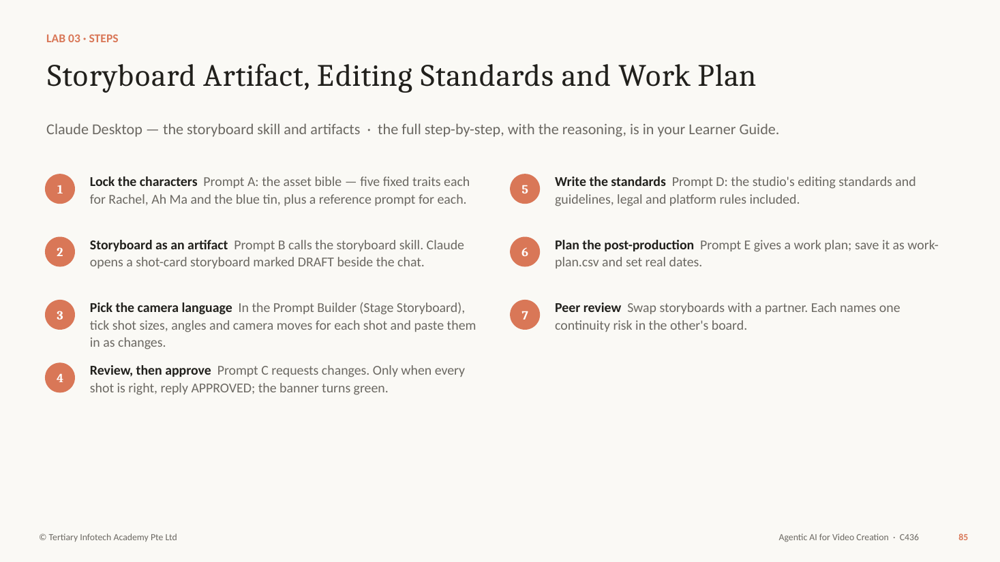

Figure — Lab 3 workflow (slide 85)

**Why each step matters**

- An asset bible lists the traits that must never change — face, hair, glasses, clothes, the prop. Video models forget; repeating the same five traits in every shot prompt, and animating from an approved reference still, is how you keep Rachel recognisable.
- The storyboard skill writes a self-contained HTML artifact: one card per shot with size, angle, camera move, action, dialogue, on-screen text, sound, asset references and the Higgsfield prompt. Artifacts block outside images and video, so the board stays text and colour — and loads anywhere.
- The approval gate is the point of the artifact. The skill stops and waits; the higgsfield-video skill will refuse to generate until it finds an approved storyboard and script.
- Editing standards are the skill at work here: guidelines every editor (and every agent) follows, written against legal requirements — copyright, personal data, fair money messaging, AI labelling — and platform standards such as loudness, safe areas and captions.
- The work plan is the skill at work here: the post-production stages in order, each with an owner, a duration and a review gate, so the episode can hit its date.

**Step-by-step**

1. **Lock the characters** — Prompt A: the asset bible — five fixed traits each for Rachel, Ah Ma and the blue tin, plus a reference prompt for each.
1. **Storyboard as an artifact** — Prompt B calls the storyboard skill. Claude opens a shot-card storyboard marked DRAFT beside the chat.
1. **Pick the camera language** — In the Prompt Builder (Stage Storyboard), tick shot sizes, angles and camera moves for each shot and paste them in as changes.
1. **Review, then approve** — Prompt C requests changes. Only when every shot is right, reply APPROVED; the banner turns green.
1. **Write the standards** — Prompt D: the studio's editing standards and guidelines, legal and platform rules included.
1. **Plan the post-production** — Prompt E gives a work plan; save it as work-plan.csv and set real dates.
1. **Peer review** — Swap storyboards with a partner. Each names one continuity risk in the other's board.

**PROMPT A — character and asset bible**

> Create the asset bible for Kopi & Coins.

> For Rachel Tan (29), Ah Ma (74) and the blue butter-cookie tin, give: role in the story, five visible traits that must never change (face, hair, clothing, accessories, colours), how they move and speak, and one reference-image prompt each (front view, neutral light, plain background, 9:16).

> Rachel: shoulder-length black hair, round tortoiseshell glasses, mustard-yellow cardigan over a white T-shirt. Ah Ma: short silver permed hair, jade bangle, floral blouse. Save it to project knowledge as 02-storyboard__asset-bible.

**PROMPT B — storyboard artifact (storyboard skill)**

> Use the storyboard skill on the approved Episode 1 script.

> Make the storyboard as an HTML artifact: six to eight shot cards for TikTok, 9:16, 60 seconds. Each card: shot ID (S01-SH01), time, shot size, camera angle, camera move (a Higgsfield preset name where one fits), the one action, characters, dialogue or VO, on-screen text, sound, continuity line and asset references.

> Faces in the upper third; text clear of the bottom 20% of the frame (35% if you also post to Reels). Respect the 180-degree rule in the video-call scene. Mark it DRAFT and stop for my review.

**PROMPT C — request changes, then approve**

> Changes to the storyboard:
> - S01-SH01: start on the $1,400 repair quote, ECU, camera [CAMERA_MOVE, e.g. Dolly In].
> - S03-SH01: high angle on the tin, camera Static.
> - Payoff shot: mirror the framing of the hook. Keep every other shot unchanged. Show me the new version.

> (When every shot is right, reply only: APPROVED)

**PROMPT D — editing standards and guidelines**

> Write the editing standards: the rules every Kopi & Coins episode must meet before it is published.

> Sections:
> 1. Brand: colours, fonts, logo position, end card.
> 2. Story: hook in the first 3 seconds, one message, pacing.
> 3. Captions: always on, accuracy, line length, safe area.
> 4. Audio: dialogue clarity, music under voice, loudness target.
> 5. Legal: music and image rights, no personal data, money messaging (general education only, no promised returns, disclaimer), labelling AI-generated content.
> 6. Platform: 9:16, 1080x1920, frame rate, duration limits, TikTok and YouTube AI-content labels.

> Make every rule checkable, with a number or a yes/no test.

**PROMPT E — post-production work plan**

> Create a post-production work plan for Episode 1 as CSV with columns: stage, task, owner, start day, duration (hours), depends on, review gate, done when.

> Stages in order: reference stills in Higgsfield, low-res draft shots, upgrade approved shots to 1080p, assembly in LahLah Video, story review, fine cut, sound mix, captions, technical QC, compliance review, approval, export, publish.

> We have 10 working days. Put a human approval gate before publish, and allow one day for regenerating failed shots.

**Check your work**

- ☐  The asset bible fixes five visible traits each for Rachel, Ah Ma and the tin, with a reference prompt each.
- ☐  The storyboard artifact has six to eight shot cards, each with one size, one angle, one camera move and one action.
- ☐  Every card has a continuity line and asset references.
- ☐  The storyboard banner reads APPROVED, and the approved file is saved as 02-storyboard__ep01-approved.
- ☐  The standards cover brand, story, captions, audio, legal and platform — each rule checkable.
- ☐  work-plan.csv lists every stage with an owner, a duration and a review gate, and fits 10 working days.

**If it goes wrong**

- **The storyboard has two actions per shot** — Split it. One shot, one action.
- **No artifact appears** — Say: "Show the storyboard as an HTML artifact, not in the chat."
- **Loudness target unclear** — Use -14 LUFS integrated with true peak no higher than -1 dBTP for social platforms; note the broadcast standard (EBU R128, -23 LUFS) for comparison.

**Stretch**

- Ask Claude to turn the editing standards into a yes/no checklist; you will reuse it in Labs 5 and 6.

Standards written down are standards Claude can follow. Standards in your head are surprises at review time.

### Topic 1 recap

#### Episode 1 Exists on Paper — and Your Studio Is Ready

Episode 1 exists on paper — fully planned.

- **Set up — Lab 1** — Five skills, the Higgsfield connector, a project and LahLah Video.
- **Planned — Lab 2** — A creative brief, a 60-second script and a review of the edits each scene needs.
- **Specified — Lab 3** — An asset bible, an approved storyboard artifact, editing standards and a 10-day work plan.

## Topic 2 — AI-Assisted Video Editing, Storytelling and Quality Assurance

Slides 93–133 · **LO2:** Assess edited footage to enhance storytelling and ensure technical compliance.

**Knowledge:** Types of solutions to rectify quality issues; Parameters to assess video quality

**Abilities:** Review edited footage to propose changes that will enhance the story and emotions in each scene; Assess edited footage against technical parameters to ensure alignment to requirements

In this topic you will learn:

- The production run: Claude shoots Episode 1 in Higgsfield
- References, camera presets and the scene prompt formula
- Draft low-res, upgrade the keepers; platforms
- Reviewing footage, parameters and fixes in LahLah Video

### Key ideas for Lab 4

#### How Claude Produces Episode 1 in Higgsfield

The higgsfield-video skill checks two approvals and a budget, generates one reference still per character and prop, drafts every shot at low resolution, upgrades only the approved drafts to 1080p, asks you to file every job in the project's Higgsfield folder, and hands over download links, lahlah-edit.json and captions.srt.

The higgsfield-video skill, step by step — it refuses to start without two approvals and a budget.

1. **Approvals** — Storyboard and script both APPROVED.
1. **Credit plan** — balance + models_explore: cost at draft and at 1080p, plus 30%.
1. **References** — generate_image: one approved still per character and prop.
1. **Low-res drafts** — Batch drafts at 480p or 720p; jobs_wait.
1. **Upgrade the keepers** — Only approved drafts re-made at 1080p.
1. **File** — Every job moved into the project's Higgsfield folder.
1. **Hand-off** — Download links, lahlah-edit.json, captions.srt.

#### References: Locking Characters and Props

Approve one reference still per character and important prop, then animate every shot from it (image-to-video). For a long series, Higgsfield's Soul ID trains an identity from 5-20 photos — use it only for fictional or consenting people.

The single biggest lever for consistency in AI video.

- **Still first** — generate_image makes a front-view still of Rachel from the asset bible. You pick one; it becomes @Rachel.
- **Animate from the still** — Every shot is image-to-video from that still, so the face is never re-invented.
- **Soul ID for a long series** — Train an identity from 5-20 photos in about 10 minutes — fictional or consenting people only.
- **Props are characters too** — The blue tin gets its own still: same colour, same dent, labels added in the editor.

#### Camera Presets That Change the Feeling

Higgsfield names 64 camera presets. Naming one in a shot prompt — Dolly In to build focus, Crash Zoom In for shock, Crane Up for release — changes how the viewer feels about the moment. Where no preset fits, describe the move in plain words.

Name the preset in the prompt; Claude matches it with presets_show. Seven of Higgsfield's 64:

| Preset | What the camera does | Episode 1 shot |
|---|---|---|
| Dolly In | Glides toward the subject; builds focus. | Slowly onto the phone with the repair quote. |
| Crash Zoom In | A fast punch-in; shock. | The bank balance lands. |
| Handheld | A slight, human shake; realism. | Rachel's late-night video call. |
| Crane Up | Rises above the scene; release. | Six months later, the calm desk. |
| Whip Pan | A fast swipe; energy and a transition. | Payday montage, one bucket after another. |
| 360 Orbit | Circles the subject; a reveal. | Ah Ma lifts the tin lid. |
| Static | No movement; calm, readable. | The end card. |

Tip: Preset names from higgsfield.ai/camera-controls; the meanings are this course's plain-English glosses.

#### The Scene Prompt Formula

Every shot prompt fills the same slots: shot size, angle, subject, one action, place and time, lighting, mood, colour grade, camera move, lens and aspect ratio, ending with "no on-screen text, no logos" because text is added in the editor.

Every shot prompt has the same nine slots. Fill them from the asset bible and the Prompt Builder chips.

**SCENE PROMPT — the formula, then Episode 1, shot 1**

```
[SHOT_SIZE] [ANGLE] of [SUBJECT], [ACTION],
in [LOCATION_TIME], [LIGHTING], [MOOD], [COLOUR_GRADE],
camera: [CAMERA_MOVE], [LENS], 9:16,
no on-screen text, no logos

Extreme close-up, eye level, of a phone glowing in a young
woman's hand, small silver watch on her wrist, her thumb
freezes, at a home desk at night, warm desk-lamp light,
tense mood, muted teal-and-amber grade,
camera: Dolly In, slow, 50mm, 9:16,
no on-screen text, no logos
```

#### The Prompt Builder: Tick, Fill, Copy

The Prompt Builder page holds a template for every stage, genre and platform. Learners pick a stage, genre and platform, tick any number of camera presets, angles and looks, fill the bracketed words and copy the result into Claude.

labs/prompt-builder.html — a template for every stage, genre and platform, ready to paste into Claude.

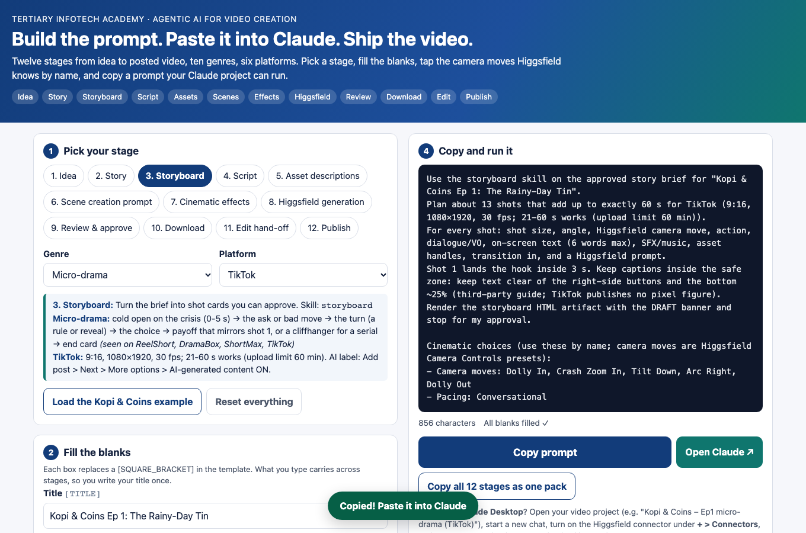

- **Pick three things** — Stage, genre (micro-drama, product ad, explainer…) and platform (TikTok, YouTube, Shorts, Reels, micro-drama apps).
- **Tick the camera language** — Any number of the 64 presets, plus angles, shot sizes, lens, lighting, mood, grade and transitions.
- **Fill the brackets** — Change only the [BRACKETED] words; the structure that works stays put.
- **Copy to Claude** — One click copies the prompt; Open Claude starts a new chat.

#### Five Seconds of Video Costs 2.5 to 60 Credits

Prices are live quotes from the Higgsfield CLI (generate cost) for a 9:16 shot on 8 November 2026. Seedance 2.0 Mini at 480p is the cheapest model that also makes sound and dialogue, at 0.5 credits a second. Hailuo has no sound option and is priced for 6 seconds at 768p. Kling 3.0 drops to 7.5 credits with sound off. Prices change, so the higgsfield-video skill prices every batch before it spends.

Same 9:16 shot, twelve Higgsfield models. Draft on the cheap rows, finish on the dear ones.

| Model | Setting | Credits | Sound | Use it for |
|---|---|---|---|---|
| Seedance 2.0 Mini | 480p · 5 s | 2.5 | Yes | Drafts: the course default |
| Seedance 2.0 Mini | 720p · 5 s | 5 | Yes | Sharper drafts |
| Wan 3.0 · Grok 1.5 Lite | 480p · 5 s | 5 | Wan only | Second-opinion drafts |
| Hailuo 2.3 | 768p · 6 s | 6 | No | Motion from a start frame |
| Veo 3.1 Lite | 4 s, audio on | 6 | Yes | Short spoken lines |
| Kling 3.0 Turbo | 720p / 1080p · 5 s | 7.5 / 10 | No | Cheapest 1080p finals |
| Kling 3.0 · Kling 2.6 | 5 s, sound on | 10 | Yes | Finals with sound |
| Kling 4.0 Flash · 4.0 | 720p / 1080p · 5 s | 15 / 16.25 | No | Complex motion, many references |
| Seedance 2.5 · 2.0 | 5 s · 2.0 at 1080p | 35 / 60 | Yes | Hero shots only |

Tip: Live quotes from higgsfield generate cost, 8 Nov 2026. Prices move: ask Claude to price every batch before it spends.

#### Draft Low-Res, Then Upgrade the Keepers

Higgsfield prices by model, length and resolution: 2.5 credits for a 5-second Seedance 2.0 Mini draft at 480p against 10 for a 5-second Kling 3.0 Turbo shot at 1080p and 35 for Seedance 2.5. Draft every shot at 480p, fix it there, then re-generate only the approved shots at 1080p.

Higgsfield prices by model, seconds and resolution. Make your mistakes where they are cheap.

**Draft at 480p or 720p**

- Seedance 2.0 Mini at 480p, sound included.
- A 5-second draft: 2.5 credits.
- Fix framing, action and continuity here.
- Re-roll freely — a draft is disposable.

**Upgrade only what you approve**

- Same still, same prompt, same preset — final model.
- Kling 3.0 Turbo, 5 s at 1080p: 10 credits.
- One 1080p shot costs four drafts; Seedance 2.5 costs 14.
- Course rule: no 1080p shot without an approved draft.

#### Plans, Budgets and Limits

The MCP connector has no credit cap of its own and always spends credits. State the budget in words, ask Claude to price every batch first, and check the live plans page before subscribing.

MCP has no credit cap of its own. You set it, in words.

- **The plans** — Plus $49 a month for 1,000 credits; Ultra $129 for 3,000; a 3-day Plus trial works through Claude only (higgsfield.ai/pricing, 8 Nov 2026).
- **The connector spends credits** — The free trial works only through the connector; on paid plans MCP generations spend credits even where the website offers unlimited ones.
- **Say the budget** — "Do not spend more than 150 credits. Ask before every batch." The skill pauses at 80%.
- **Check the live page** — Plans, bonuses and model prices change monthly — confirm before you subscribe.

#### Where Your Episode Lives

Each platform sets its own frame, length and AI-label rules: TikTok and Shorts are 9:16, YouTube 16:9; Shorts run up to 3 minutes; micro-drama apps such as ReelShort use 1-2 minute episodes in long seasons. TikTok and YouTube both ask you to label realistic AI content.

Frame, length and the AI label for each platform (checked 8 Nov 2026). Micro-drama apps: ReelShort, DramaBox, ShortMax.

| Platform | Frame | Length | AI label |
|---|---|---|---|
| TikTok | 9:16 · 1080x1920 | Uploads to 60 min; land the hook in 3 s | More options > AI-generated content |
| YouTube | 16:9 · 1920x1080 | 15 min until the account is verified | Studio > Attributes > AI use |
| YouTube Shorts | 9:16 · 1080x1920 | Up to 3 min | Same AI use setting |
| Instagram Reels | 9:16 · 1080x1920 | Up to 20 min; keep 14% top and 35% bottom clear | AI label toggle (wording awaiting verification) |
| Micro-drama apps | 9:16 | 1-2 min episodes; ReelShort seasons run 70-80 | No public spec |

Tip: Platforms change their limits often. Check the help page before each campaign.

#### Directing Claude and Higgsfield

Six habits keep a production on budget: approve before you spend, name the skill, make references first, keep one action per shot, draft low and upgrade the keepers, and say exactly what to keep when you ask for a change.

Six habits that turn credits into a usable cut.

1. **Approve before you spend** — Storyboard, script and budget — in that order.
1. **Name the skill** — "Use the video-script skill on the approved board" beats twenty lines of instructions.
1. **References first** — A still for every character and important prop.
1. **One shot, one action** — Split any shot that does two things.
1. **Draft low, upgrade the keepers** — 480p or 720p first; 1080p only for approved drafts.
1. **Say what to keep** — "Re-roll S03-SH01 only; keep everything else."

### Lab 4 — Create Episode 1 with Claude and Higgsfield

**The story so far:** The storyboard is approved and Priya has set a credit budget. Your job today: get every shot of Episode 1 made in Higgsfield, with Rachel, Ah Ma and the tin the same in every shot, filed in one Higgsfield folder, and downloaded ready to edit — without spending full-resolution credits on shots you will throw away.

**Goal:** Direct Claude to produce the episode in Higgsfield — script, prompts, approval, budget, references, low-res drafts, then high-res finals — and keep every asset traceable in one Higgsfield folder.

**You'll produce:** Higgsfield folder "Kopi & Coins – Ep1 micro-drama (TikTok)" with reference stills, drafts and finals; clips saved as S01-SH01.mp4 …; lahlah-edit.json and captions.srt

**Agent:** Claude Desktop + Higgsfield MCP — the video-script and higgsfield-video skills  ·  **Time:** 75 min  ·  **Slides:** 104–110

**Lab folder:** labs/lab-04-create-episode-1-in-higgsfield/ — assets/scene-prompts-ep01.pdf, assets/cinematic-effects-cheatsheet.pdf, assets/credit-plan-template.csv, assets/sample/lahlah-edit.json, assets/sample/captions.srt, assets/sample/status-table.pdf

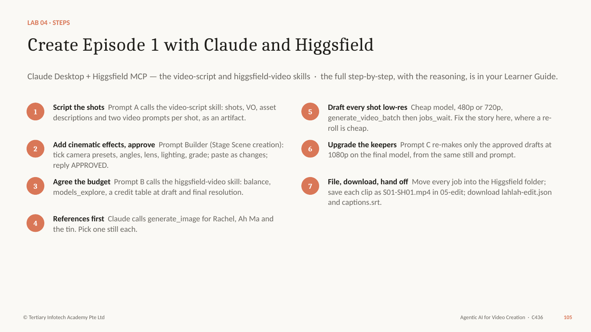

Figure — Lab 4 workflow (slide 105)

**Why each step matters**

- The video-script skill turns each storyboard card into a shot that a model can make: one action, the asset's five traits, one camera move, the lighting and grade, and the aspect ratio. It writes an image-to-video prompt (animate from a reference still) and a text-to-video fallback.
- Cinematic effects are Higgsfield's named camera presets — Dolly In, Crash Zoom In, Whip Pan, 360 Orbit, Crane Up, FPV Drone, Bullet Time and 57 more. Claude matches each shot to a preset from presets_show; where no preset fits, it writes the move into the prompt in plain words.
- Draft low, finish high. Higgsfield prices by model, length and resolution: an 8-second Kling 3.0 shot at 720p costs about 16 credits; an 8-second Seedance 2.5 shot at 1080p about 72. Test framing, action and continuity on cheap low-res drafts, then spend high-res credits only on the shots you keep.
- References first is the consistency rule: approve one still per character and prop, then animate every shot from that still. A face that never has to be re-invented cannot drift.
- Higgsfield files MCP generations in Assets. Make a folder with the project's name and Move every job into it — the skill lists the job IDs. Claude cannot fetch the MP4s itself; you click each result link and save the clip.

**Step-by-step**

1. **Script the shots** — Prompt A calls the video-script skill: shots, VO, asset descriptions and two video prompts per shot, as an artifact.
1. **Add cinematic effects, approve** — Prompt Builder (Stage Scene creation): tick camera presets, angles, lens, lighting, grade; paste as changes; reply APPROVED.
1. **Agree the budget** — Prompt B calls the higgsfield-video skill: balance, models_explore, a credit table at draft and final resolution.
1. **References first** — Claude calls generate_image for Rachel, Ah Ma and the tin. Pick one still each.
1. **Draft every shot low-res** — Cheap model, 480p or 720p, generate_video_batch then jobs_wait. Fix the story here, where a re-roll is cheap.
1. **Upgrade the keepers** — Prompt C re-makes only the approved drafts at 1080p on the final model, from the same still and prompt.
1. **File, download, hand off** — Move every job into the Higgsfield folder; save each clip as S01-SH01.mp4 in 05-edit; download lahlah-edit.json and captions.srt.

**PROMPT A — shots, assets and video prompts (video-script skill)**

> Use the video-script skill on the approved storyboard.

> For every shot give: shot ID, timeline seconds, the one action, dialogue or VO, on-screen text (added in the editor, never generated), the assets in shot with their five fixed traits, and two prompts:
> - i2v: animate from the approved reference still;
> - t2v: fallback with no still.

> Scene prompt formula:
> [SHOT_SIZE] [ANGLE] of [SUBJECT], [ACTION], in [LOCATION_TIME], [LIGHTING], [MOOD], [COLOUR_GRADE], camera: [CAMERA_MOVE], [LENS], 9:16, no on-screen text, no logos.

> Show it as an HTML artifact marked DRAFT and stop.

**PROMPT B — budget, references, low-res drafts (higgsfield-video skill)**

> Use the higgsfield-video skill to produce Episode 1.

> 1. Check the storyboard and script are APPROVED.
> 2. Call balance and models_explore: a cheap draft model (480p or 720p) and a final model (1080p).
> 3. Credit table: stills, low-res drafts, 1080p upgrades, +30%. Budget [BUDGET] credits. Ask before every batch.
> 4. On Go: generate_image for Rachel, Ah Ma and the tin; wait for my picks.
> 5. Draft every shot LOW-RES with generate_video_batch; poll jobs_wait; keep the status table. No 1080p yet.
> 6. Folder: "Kopi & Coins – Ep1 micro-drama (TikTok)". List the job IDs to Move into it.

**PROMPT C — upgrade the keepers to high resolution**

> These drafts are approved: [SHOT_IDS]. Re-generate ONLY these at 1080p on the final model, from the same reference still, the same prompt and the same camera preset. Show the cost first. Leave rejected drafts alone. Add the new job IDs to the status table and the folder list.

**PROMPT D — re-roll one draft, then hand off**

> S03-SH01 drifted: the tin has no dent and the labels are garbled. Re-roll this LOW-RES draft only, from the approved tin still, camera Static, no text in the prompt — we add the labels in LahLah Video.

> When every shot is final, write lahlah-edit.json (schema lahlah-edit/1, platform tiktok, 9:16, 30 fps, clips in timeline order with trim_in and trim_out, transitions from the storyboard, captions in timeline seconds) and captions.srt. Give me the 1080p download links in order, named S01-SH01.mp4 and so on, and the total credits spent.

**Check your work**

- ☐  The script artifact is APPROVED, with an i2v and a t2v prompt and one camera move for every shot.
- ☐  A credit table at draft and final resolution was approved before any generation.
- ☐  One approved reference still each for Rachel, Ah Ma and the tin.
- ☐  Every shot was drafted low-res first; only approved drafts were upgraded to 1080p.
- ☐  Every still, draft and final sits in the Higgsfield folder named after the project, with its job ID in the status table.
- ☐  The 1080p clips are saved in 05-edit as S01-SH01.mp4 …, with lahlah-edit.json and captions.srt beside them.

**If it goes wrong**

- **Credits run out mid-batch** — Stop. Keep the low-res drafts and use the mock clips from Lab 5 for missing shots; upgrade later.
- **A job returns ip_detected** — Confirm you hold the rights (fictional characters only) before Claude calls reveal_generation.
- **Rachel's glasses disappear** — Re-roll the draft from the approved still, repeat the five traits, keep the shot under 6 seconds.
- **Claude cannot download the MP4** — Expected. Click each result link and Save video as…, or download from Higgsfield Assets.

**Stretch**

- Ask Claude to draft one hero shot twice at low res — one with Dolly In, one with Crash Zoom In — and upgrade only the one that lands the hook.

Draft low, finish high. A re-roll at 480p costs a fraction of one at 1080p — make your mistakes where they are cheap.

### Key ideas for Lab 5

#### Reviewing Edited Footage: Two Passes

Review edited footage twice. The story pass asks what the viewer feels in each scene and what change would strengthen it. The technical pass measures each parameter against its target.

Two different questions — do them separately.

- **Pass 1 · Story and emotion** — Watch as a viewer, on a phone. For each scene: what should I feel, what do I feel, what change would close the gap?
- **Pass 2 · Technical** — Watch as an engineer. For each parameter: what is the value, what is the target, pass or fail?
- **Then prioritise** — Choose the three fixes that matter most. A review that lists 20 problems fixes none.

#### A Scene-by-Scene Story Review

Propose changes that strengthen the story and the emotion in each scene.

| Scene | Intended feeling | Ask | Typical change |
|---|---|---|---|
| Hook | Shock, recognition | Do I understand the problem in 3 s? | Start on the quote, not the room. |
| Set-up | Embarrassment, warmth | Do I care about Rachel yet? | Hold her reaction a beat longer. |
| Turn | Surprise, curiosity | Is the reveal clear? | Close-up on the labels; add the lid sound. |
| Choice | Determination | Does it drag? | Montage of three paydays. |
| Payoff | Relief, pride | Is the contrast with the hook obvious? | Mirror the opening shot. |
| End card | Clarity | Is the action clear and readable? | One line; on screen 3+ s. |

#### Emotion, Pacing and Rhythm

Editing controls emotion: shot length sets energy, reaction shots let us feel through a character, music and silence frame a reveal, and a payoff that mirrors the hook makes the change visible.

The edit decides how a scene feels — often more than the picture.

- **Shot length** — Short shots raise energy; a held shot lets a feeling land. Vary them.
- **Reaction shots** — We feel through faces. Cut to Rachel when Ah Ma opens the tin.
- **Music and silence** — A music drop before the reveal makes it land.
- **Contrast** — The payoff mirrors the hook: same framing, opposite feeling.

#### Case Study: 过来人 The OGs

The OGs is a 4 minute 41 second AI music video in which ten figures from Chinese history rap their setbacks as modern office problems. Its on-screen credit says it was made on LibTV. It works because six things never change — set, lighting, microphone, crowd, camera arc and graphics — while the singer and framing do. Trainer: PowerPoint blocks online video in decks it did not create; click Enable Content on the yellow bar, then click the video in Slide Show.

A 4:41 AI music video: ten performers, about 100 cuts, one room. Made on LibTV (its on-screen credit). Here is how you would rebuild it with Claude and Higgsfield.

**Watch:** 过来人 The OGs — AI music video — https://youtu.be/eKynQcweb7M

Video: 喆FILM. Analysis: The MacDoctor teardown, 6 Nov 2026. Click Enable Content, then click the video in Slide Show.

- **The concept** — Ten figures from Chinese history rap their famous setbacks as modern office pains: rent, layoffs, KPIs, the age-35 wall.
- **The structure** — Three 45-48 s verses, then a cypher of seven 6-16 s turns. Energy builds as the faces turn over faster.
- **The lock** — One set, one lighting recipe, one chrome microphone, one recurring crowd: 100 shots read as one night.
- **The label** — AI disclosure on screen from the very first shot.

#### Rebuild It: Claude Writes, Higgsfield Generates, You Edit

A rebuild runs in six phases: song, bible, assets, keyframes, motion and edit. Claude writes the lyrics, bible blocks and every prompt; Higgsfield makes the stills and performance takes; the editor lays the master audio first and cuts on lyric lines.

Six phases from the teardown's rebuild plan, mapped to this course's skills.

| Phase | What you make | Skill or tool |
|---|---|---|
| Song | Original lyrics: one figure, one setback, one modern pain, one gag per verse. Vocals with one dry stem per singer and a timing sheet. | storytelling skill; an AI singing tool |
| Bible | Set, lighting and microphone blocks plus a 25-40-word description per character, pasted into every prompt. | storyboard skill (asset bible) |
| Assets | Ten character sheets, a crowd persona sheet, a mic prop sheet and 4-6 empty plates of the hall. | higgsfield-video: generate_image (Seedream 5.0 or GPT Image 2.5) |
| Keyframes | One still per hero shot; approve light and composition while it is cheap. | higgsfield-video |
| Motion | Performance takes with the vocal stem as audio reference; silent crowd reactions on a cheap model; drafts at 480p first. | Seedance 2.5; Kling 3.0 Turbo |
| Edit | Master audio first, cut on lyric lines, reaction shots over the joins, name cards, captions, 1080p24 plus a 9:16 cut. | LahLah Video or CapCut |

Tip: Model choices follow the teardown and the live Higgsfield catalogue; run models_explore before you plan a budget.

#### Five Tricks to Steal from The OGs

Generate long takes and cut them short, keep shots to 2-3 seconds so faces never drift, cast a recurring crowd of viewer personas, lock six things, and put the AI disclosure on screen from the first shot.

Copy the system, not the lines.

- **Generate long, cut short** — One 10-15 s take per 3-5 lyric lines, cut into 3-4 shots: about 5 takes make a 45 s verse.
- **Hide drift in short shots** — An average shot of 2-3 s means no generation has to hold a face for long.
- **Cast the crowd** — Recurring modern personas — office worker, delivery rider, tired dad — each a viewer who sees themself.
- **Lock six things** — Set, light, prop, crowd, camera arc and graphics stay fixed; only the singer and framing change.
- **Label it on screen** — The AI disclosure is part of the design, not a footnote.

#### Parameters to Assess Video Quality: Picture

Measurable qualities, each with a target for a 60-second vertical episode.

| Parameter | What it measures | Target |
|---|---|---|
| Resolution / aspect ratio | Pixel size and shape of the frame. | 1080x1920, 9:16 — never a low-res draft. |
| Frame rate | Frames per second; constant or variable. | 24, 25 or 30 fps, constant. |
| Duration | Total running time. | 55-60 s; end card ≥ 3 s. |
| Bitrate / compression | Detail kept after encoding. | No visible blocking in motion or dark areas. |
| Exposure and colour | Brightness, contrast and colour consistency. | Shots match; no crushed blacks or blown skies. |
| Sharpness and artefacts | Focus, flicker, warping. | No AI artefacts on faces, hands or text. |

#### Parameters to Assess Video Quality: Sound, Text, Continuity

The parameters reviewers miss most often.

| Parameter | What it measures | Target |
|---|---|---|
| Loudness and peaks | Integrated loudness (LUFS), true peak. | About -14 LUFS; true peak ≤ -1 dBTP. |
| Dialogue clarity | Voice level against music and effects. | Music ducked under voice; every word clear. |
| A/V and lip-sync | Sound in time with picture. | No visible offset. |
| Captions | Accuracy, timing, length, position. | 100% match; ≤ 2 lines; inside the safe zone. |
| Continuity | Characters, props, light, screen direction. | Matches the asset bible and the previous shot. |
| Story clarity | Hook, message, call to action. | Message clear with sound off. |

#### Types of Solutions to Rectify Quality Issues

Each kind of issue has a matching kind of solution: regenerate with locked references, re-edit on the timeline, re-mix the audio, re-caption, replace generated text with a graphic, or re-export and enhance. Choose the cheapest solution that fixes the problem, and prevent it next time in the prompt or the reference.

Match every issue to the cheapest solution that fixes it.

| Issue | Solution type | How, in practice |
|---|---|---|
| Face or prop drift | Regenerate from the locked reference | Re-roll that shot's low-res draft from the approved still; upgrade once it holds. |
| Scene drags / weak hook | Re-edit: trim, re-order, re-time | Shorten on the timeline; start on the strongest frame. |
| Music drowns the voice | Audio mix: ducking, normalising | Lower music under voice; normalise to the loudness target. |
| Wrong or missing captions | Re-caption and proofread | Re-import captions.srt or auto-caption; correct every line. |
| Garbled on-screen text | Replace with a graphic overlay | Add text in the editor instead of generating it in the shot. |
| Low detail / soft image | Upgrade or re-export | Swap the draft for its 1080p upgrade; export at 1080p. |

Tip: Prevention beats repair: most fixes started as a missing reference or an unclear prompt.

#### Where to Fix It — Cheapest First

Fix in the editor first, then the prompt, then the reference still, and only then pay for a new 1080p upgrade.

Four places to make a change, from free to costly.

- **The editor** — Trim, re-order, duck the music, re-caption in LahLah Video or CapCut — no credits at all.
- **The prompt** — Change one shot's prompt in Claude and re-roll its low-res draft.
- **The reference** — Re-pick or re-make the still when a face or a prop drifts.
- **The 1080p upgrade** — Only after the draft passes — the costly step, used last.

#### LahLah Video — CapCut-Style Editing, Installed by Claude

LahLah Video is a free desktop editor for Mac and Windows. It opens the lahlah-edit.json file Claude writes, offers the CapCut-style tools an editor expects, and takes plain-English commands that LahLah Voice or Windows voice typing can dictate.

A free desktop editor for Mac and Windows that opens Claude's hand-off file and takes voice commands.

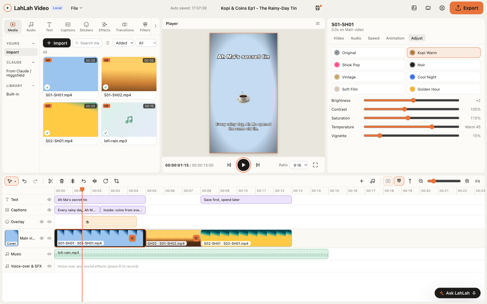

- **Opens the hand-off** — lahlah-edit.json lays the clips, trims, transitions and captions on a 9:16 canvas.
- **The tools you expect** — Multi-track timeline, split, speed, transitions, filters, text, captions, music, export presets.
- **Edit by voice** — Click Ask LahLah or press Cmd/Ctrl+K, then say "split at 3 seconds". LahLah Voice (Mac) or Win+H types it for you.
- **One prompt to install** — Ask Claude to install it — or download the .dmg or .exe.

#### Claude Cuts the Rough Edit While You Watch

LahLah Video ships a Claude Desktop extension (lahlah-video.mcpb) with eleven tools. Claude opens the hand-off, applies edit commands, sets captions, takes a snapshot frame for you to check and exports for TikTok or YouTube. The editor listens only on 127.0.0.1 and needs the API key from Settings › API; regenerate the key if it is ever shared.

Install the LahLah Video extension and Claude drives the editor directly: open, split, caption, export.

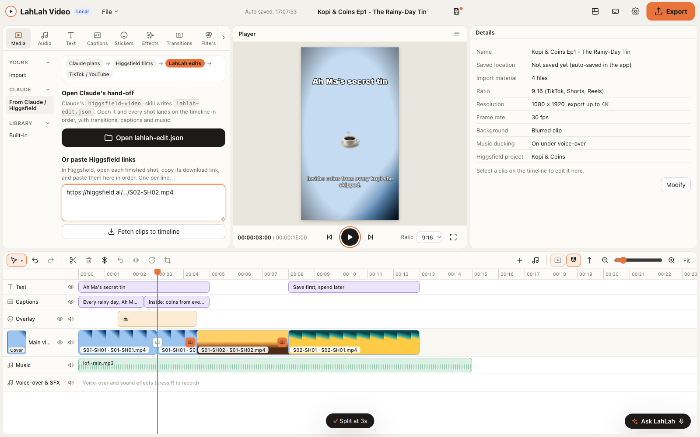

- **One double-click** — lahlah-video.mcpb adds the connector to Claude Desktop. No config file to edit.
- **Eleven tools** — open_handoff, add_clips, run_command, set_captions, export, snapshot and more: Claude edits, you approve.
- **From Claude / Higgsfield** — Open the hand-off or paste Higgsfield download links; each shot lands on the timeline in order.
- **Your key stays local** — Settings › API holds the key. The editor only listens on your own computer.

#### LahLah Video or CapCut?

Both editors cut the episode. LahLah Video reads Claude's hand-off file and takes voice commands; CapCut brings auto captions, templates and effects but needs the clips and captions imported by hand, and some features need CapCut Pro.

Both cut the episode. Pick by how you like to work.

**LahLah Video (course default)**

- Opens lahlah-edit.json: clips, trims and captions in one click.
- Voice commands from LahLah Voice or Win+H.
- Free; no watermark; installed by one prompt to Claude.
- Export presets for TikTok, Shorts and YouTube.

**CapCut desktop**

- Auto captions in 30+ languages, templates and effects.
- Import clips in filename order; Captions > Import file for the .srt.
- Cannot read lahlah-edit.json — trim by hand.
- 4K, 60 fps and Pro-badged assets need CapCut Pro.

#### The Technical QC Procedure

Technical QC compares the edited footage with measurable targets: resolution, frame rate, duration, loudness, captions and continuity. Record the actual value, the target and PASS or FAIL, so that anyone can repeat the check.

Assess edited footage against parameters — the same way every time.

1. **Check the export** — Read resolution, frame rate and duration from the export settings or file info.
1. **Play full screen on the target device** — A phone, sound on, then sound off.
1. **Measure the sound** — Loudness and peaks with a meter; listen for clipping and buried voice.
1. **Read every caption** — Against the script, for timing and position.
1. **Compare adjacent shots** — Faces, props, light, direction.
1. **Record and decide** — Value, target, PASS or FAIL, evidence — then fix and re-check.

Tip: A QC report without values is an opinion. Record the number.

#### Measuring the File (Trainer Demo)

Two commands that turn "looks fine" into evidence. FFmpeg is free.

**COMMANDS — ffprobe and ffmpeg**

```
# resolution, frame rate and duration
ffprobe -v error -select_streams v:0 \
  -show_entries stream=width,height,r_frame_rate:format=duration \
  -of default=nw=1 EP01_v1.mp4

# integrated loudness (LUFS) and true peak (dBTP)
ffmpeg -i EP01_v1.mp4 -af loudnorm=print_format=summary -f null -

# expected for TikTok: width=1080 height=1920, 30/1 fps,
# duration about 60, Input Integrated about -14 LUFS,
# Input True Peak no higher than -1 dBTP
```

### Lab 5 — Edit, Review and Refine in LahLah Video

**The story so far:** The shots are in. Priya watches the assembled cut on her phone and says: "Something's off, but I can't say what." Your job: build the cut, review it twice — once for story, once for technical quality — and fix what matters most.

**Goal:** Assemble the episode, assess it against the story and the technical parameters, and propose and make the changes that improve it.

**You'll produce:** EP01_v1.mp4 and EP01_v2.mp4, a story review, a QC report with values, and a fix log

**Agent:** LahLah Video (or CapCut) + Claude Desktop  ·  **Time:** 80 min  ·  **Slides:** 126–132

**Lab folder:** labs/lab-05-edit-review-and-refine-in-lahlah-video/ — assets/mock-clips/S01-SH01.mp4, assets/mock-clips/S02-SH01.mp4, assets/mock-clips/S03-SH01.mp4, assets/mock-clips/S04-SH01.mp4, assets/mock-clips/S05-SH01.mp4, assets/mock-clips/S06-SH01.mp4, assets/mock-clips/music-bed.mp3, assets/mock-clips/lahlah-edit.json, assets/mock-clips/captions.srt, assets/voice-commands.pdf, assets/story-review-template.pdf, assets/qc-checklist.pdf, assets/fix-log-template.csv, assets/sample/qc-report.pdf

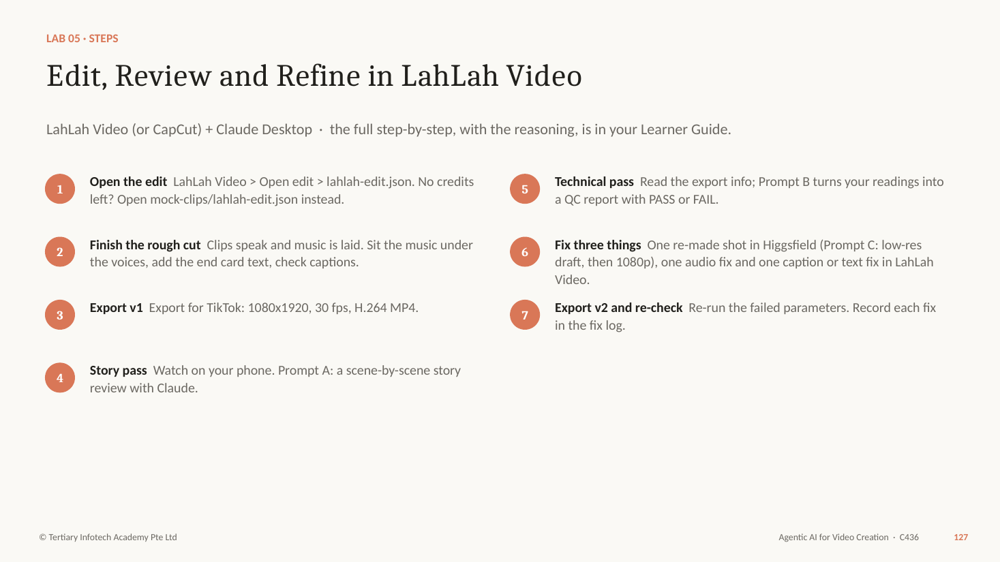

Figure — Lab 5 workflow (slide 127)

**Why each step matters**

- LahLah Video reads the hand-off file Claude wrote: the clips in order, trimmed, with transitions and captions on a 9:16 canvas. CapCut does the same job by hand — import the clips in filename order, then Captions > Import file for the .srt.
- Voice commands make editing hands-free: press Cmd/Ctrl+K and say "split at 3 seconds", "add crossfade" or "export for TikTok". On a Mac, LahLah Voice types the words for you; on Windows, Win+H does the same.
- Review twice, separately. The story pass asks what the viewer feels in each scene. The technical pass measures each parameter against its target. Mixing them gives a muddled list.
- Choose the cheapest fix that works: trim or re-order before re-generating; re-mix the audio before replacing the music; add text in the editor instead of generating it; and when you must re-generate, draft the fix at low res before paying for 1080p.
- A QC report without values is an opinion. Record the number: 1080x1920, 30 fps, 59.5 s, -14.2 LUFS.

**Step-by-step**

1. **Open the edit** — LahLah Video > Open edit > lahlah-edit.json. No credits left? Open mock-clips/lahlah-edit.json instead.
1. **Finish the rough cut** — Clips speak and music is laid. Sit the music under the voices, add the end card text, check captions.
1. **Export v1** — Export for TikTok: 1080x1920, 30 fps, H.264 MP4.
1. **Story pass** — Watch on your phone. Prompt A: a scene-by-scene story review with Claude.
1. **Technical pass** — Read the export info; Prompt B turns your readings into a QC report with PASS or FAIL.
1. **Fix three things** — One re-made shot in Higgsfield (Prompt C: low-res draft, then 1080p), one audio fix and one caption or text fix in LahLah Video.
1. **Export v2 and re-check** — Re-run the failed parameters. Record each fix in the fix log.

**PROMPT A — story review**

> I watched EP01_v1 on my phone. Here are my notes per scene:
> [YOUR NOTES]

> Make a story review table, one row per scene: intended feeling, the feeling it actually creates, and one specific change that would strengthen the story and emotion (pacing, shot order, reaction shot, music, text). Then rank the three changes that matter most.

**PROMPT B — technical QC report**

> Here are the readings for EP01_v1:
> resolution [W x H], frame rate [FPS], duration [SECONDS], loudness [LUFS] and true peak [dBTP], caption errors [N], continuity notes [NOTES].

> Check each against the editing standards in this project. Return a table: parameter, value, target, PASS or FAIL, evidence, fix. Use the cheapest fix that works.

**PROMPT C — re-make one shot (higgsfield-video skill)**

> Use the higgsfield-video skill. Re-make [SHOT_ID] only, from the approved reference still, with this change: [CHANGE]. Camera [CAMERA_MOVE]. Draft it low-res first and show me; only after I approve, upgrade it to 1080p on the final model. Show the cost of each step, file both jobs in the Ep1 Higgsfield folder, and update lahlah-edit.json with the new src.

**COMMANDS — read the file (optional, FFmpeg)**

```
# resolution, frame rate and duration
ffprobe -v error -select_streams v:0 \
  -show_entries stream=width,height,r_frame_rate:format=duration \
  -of default=nw=1 EP01_v1.mp4

# integrated loudness (LUFS) and true peak (dBTP)
ffmpeg -i EP01_v1.mp4 -af loudnorm=print_format=summary -f null -
```

**Check your work**

- ☐  EP01_v1.mp4 exported at 1080x1920, 9:16.
- ☐  The story review covers every scene with intended vs actual feeling and a specific change.
- ☐  The QC report has at least six parameters with values, targets and PASS or FAIL.
- ☐  Three fixes made — one in Higgsfield (drafted low-res first), two in the editor — each in the fix log.
- ☐  EP01_v2.mp4 passes every parameter that failed in v1.
- ☐  Screenshots of the LahLah Video timeline and the export settings saved as evidence.

**If it goes wrong**

- **LahLah Video will not open the JSON** — Check that the clips sit beside it with the same names; or import the clips by hand and load captions.srt.
- **Voice command not understood** — Open the cheat sheet (voice-commands.pdf) and use the exact wording.
- **Export is soft** — Export at 1080p, not 720p; check you used the upgraded 1080p clips, not the low-res drafts.

**Stretch**

- Cut a 15-second teaser from the same clips using only voice commands.

Fix the cut, not the credits. Most problems disappear with a trim, a re-order or a caption — regenerate last.

### Topic 2 recap

#### Episode 1 Is Shot, Cut and Fixed

Episode 1 is made, reviewed and fixed.

- **Made — Lab 4** — Reference stills, low-res drafts and 1080p finals in one Higgsfield folder, plus a hand-off file.
- **Reviewed and fixed — Lab 5** — A cut in LahLah Video, a story review, a QC report with values, three fixes and v2.
- **Next — Topic 3** — Make it repeatable and compliant: your own skill, a remedial plan, then your own short film to upload.

## Topic 3 — Workflow Optimisation, Industry Compliance and Emerging Video Technologies

Slides 134–164 · **LO3:** Develop remedial actions to ensure industry compliance and facilitate the adoption of new technologies in visual editing.

**Knowledge:** Industry quality standards; Technologies that improve efficiency and quality of video edits

**Abilities:** Develop remedial actions to resolve issues that do not comply with industry standards; Facilitate the adoption of new technologies to improve the efficiency and quality of visual outputs

In this topic you will learn:

- Claude Skills: the studio's know-how as files
- Industry quality standards and remedial actions
- Publishing to TikTok and YouTube with the AI label on
- Emerging video technology and adopting it well

### Key ideas for Lab 6

#### One Producer, a Studio's Worth of Know-How

A studio scales when its way of working lives somewhere reusable: skills hold the know-how, connectors hold the tools, projects hold the memory, and approval gates keep people accountable.

Two episodes a week without hiring: put the studio's way of working where Claude can reuse it.

- **Skills hold the know-how** — Six SKILL.md folders: storytelling to publishing, plus your compliance review.
- **Connectors hold the tools** — Higgsfield over MCP today; any other MCP server tomorrow.
- **Projects hold the memory** — One project and one Higgsfield folder per episode, filed by stage.
- **Gates keep people in charge** — You approve the board, the script, the budget, the cut and the upload.

#### Six Skills for a Video Studio

Six skills cover the pipeline: storytelling, storyboard, video-script, higgsfield-video, kopi-compliance-review and platform-publish. Each does one job and hands a named file to the next.

Each skill is one job, written once, loaded when the task matches.

| Skill | The job | Hands to |
|---|---|---|
| storytelling | Idea to brief, logline, beats and a timed script. | storyboard |
| storyboard | Shot cards as an HTML artifact; stops for approval. | video-script |
| video-script | Shots, assets, VO and i2v/t2v prompts with camera presets. | higgsfield-video |
| higgsfield-video | Budget, references, low-res drafts, 1080p upgrades, folder, hand-off. | LahLah Video or CapCut |
| kopi-compliance-review | The studio's standards as a repeatable review — your own (Lab 6). | a person who approves |
| platform-publish | Export, title, hashtags, AI label, private upload plan. | TikTok or YouTube |

#### Anatomy of a Skill — SKILL.md

A skill is a folder whose SKILL.md starts with a name and a description that says when to use it, followed by the procedure and the pitfalls. Claude reads only the description until a task matches, then loads the rest.

A skill is a folder with SKILL.md. This is the one you install in Lab 6 (shortened).

**SKILL.md — inside kopi-compliance-review.zip**

```
---
name: kopi-compliance-review
description: Review a Kopi & Coins episode against the studio's
  standards and industry standards; report findings with
  evidence, risk and a remedial action. Use before approval.
---
# When to use
Before an episode goes to human approval or upload.
# Procedure
1. Read references/standards.md, the QC report, captions.srt,
   the approved script and the upload plan.
2. Check platform specs, loudness, captions and safe areas,
   copyright, personal data, money messaging, AI label.
3. One row per finding: standard, evidence, risk, remedy, owner.
4. Mark anything you cannot verify as UNVERIFIED.
# Pitfalls
Never edit the video. Never approve - only a human approves.
```

#### Install and Call a Skill in Claude Desktop

Turn on code execution, zip one folder named like the skill, upload it under Customize > Skills, switch it on, call it by name, and improve it by editing SKILL.md and re-uploading.

Six steps from a folder to a skill Claude uses on every episode.

1. **Turn on code execution** — Settings > Capabilities > Code execution and file creation.
1. **Zip one folder** — The ZIP holds one folder named exactly like the skill, SKILL.md at its root.
1. **Upload** — Customize > Skills > + > Upload a skill.
1. **Switch it on** — Toggle it on; it now shows in every chat.
1. **Call it by name** — "Use the kopi-compliance-review skill on EP01_v2."
1. **Improve it** — Edit SKILL.md, re-zip, re-upload: the next episode is checked for the new rule.

#### Industry Quality Standards: Technical

Industry quality standards are published, measurable rules — loudness, colour, platform specifications and accessibility. A video that meets them plays correctly and comfortably wherever it is published.

The published standards a professional video is measured against.

| Standard | What it sets | How you check |
|---|---|---|
| EBU R128 / ATSC A/85 | Broadcast loudness: -23 LUFS / -24 LKFS; true peak ≤ -1 dBTP. | Loudness meter on the final mix. |
| Platform loudness | Streaming normalises near -14 LUFS. | Measure; avoid heavy limiting. |
| ITU-R BT.709 | HD colour space and range. | Scopes; consistent shots. |
| Platform specifications | Aspect ratio, resolution, codec, duration, safe areas. | Export settings against the help page. |
| WCAG 2.2 (1.2.2) | Captions for prerecorded audio. | Every spoken line captioned and accurate. |

#### Industry Quality Standards: Content and Legal

Content standards protect viewers and the publisher: rights to every asset, personal data protection, fair and lawful money messaging, honest advertising and clear labelling of AI-generated media.

Standards that protect the audience — and the studio.

| Standard | What it requires | Kopi & Coins check |
|---|---|---|
| Copyright Act 2021 | Permission or licence for music, images and footage. | Licence recorded for every track. |
| PDPA | No personal data without consent. | Fictional people; no real account screens. |
| Financial Advisers Act (MAS) | Product recommendations are regulated advice. | General education; disclaimer on end card. |
| SCAP (ASAS) | Advertising must be legal, decent, honest and truthful. | No promised returns; sponsorship labelled. |
| TikTok and YouTube AI rules | Label realistic AI-generated media. | AI label on at upload, every episode. |
| C2PA Content Credentials | Provenance metadata for media. | Keep credentials; TikTok auto-labels them. |

#### From Non-Compliance to Remedy

Every finding needs a corrective action, an owner and a date.

| Non-compliance | Standard | Remedial action | Owner |
|---|---|---|---|
| Voice says "your savings will grow 8%" | FAA / SCAP | Rewrite to general wording; re-voice the line. | Scriptwriter |
| Music licence not recorded | Copyright | Replace with licensed track; log the licence. | Editor |
| Mix at -9 LUFS, clipping | Platform loudness | Re-mix to about -14 LUFS, peak ≤ -1 dBTP. | Editor |
| Captions under the UI bar | Platform safe area | Move captions up; re-export. | Editor |
| No AI label in the upload plan | Platform policy | Switch the label on in the upload plan. | Publisher |

#### Developing a Remedial Action Plan

A remedial action plan turns each non-compliance into a corrective action with an owner and a due date, ordered by risk. The final step — updating the standard or the skill — stops the same issue returning in the next episode.

A repeatable way to resolve issues that do not comply with industry standards.

1. **Identify** — Find the issue and the evidence: timecode, frame, reading.
1. **Reference the standard** — Name the rule it breaks and why it matters.
1. **Assess the risk** — High: legal or reputational. Medium: viewer experience. Low: polish.
1. **Decide the action** — Correct, replace, re-edit or withdraw — and prevent it recurring.
1. **Assign and schedule** — One owner, one due date, high risks first.
1. **Verify and record** — Re-check after the fix; add a rule to the skill so it does not return.

Tip: The last step is what makes a studio better: fix the process, not just the episode.

### Lab 6 — Build a Compliance Skill and Plan Remedial Actions

**The story so far:** Episode 1 v2 looks good. Before Priya signs it off, the studio needs a review that checks every episode the same way — and a plan for anything that fails.

**Goal:** Package the studio's standards as a Claude skill, run it on Episode 1, and turn every finding into a remedial action with an owner and a check.

**You'll produce:** kopi-compliance-review skill installed; a compliance report for EP01_v2; a remedial action plan; EP01_v3

**Agent:** Claude Desktop — your own skill: kopi-compliance-review  ·  **Time:** 80 min  ·  **Slides:** 143–148

**Lab folder:** labs/lab-06-compliance-skill-and-remedial-actions/ — assets/skills/kopi-compliance-review.zip, assets/standards.pdf, assets/episode-01-v2-notes.pdf, assets/remedial-action-template.csv, assets/sample/compliance-report.pdf

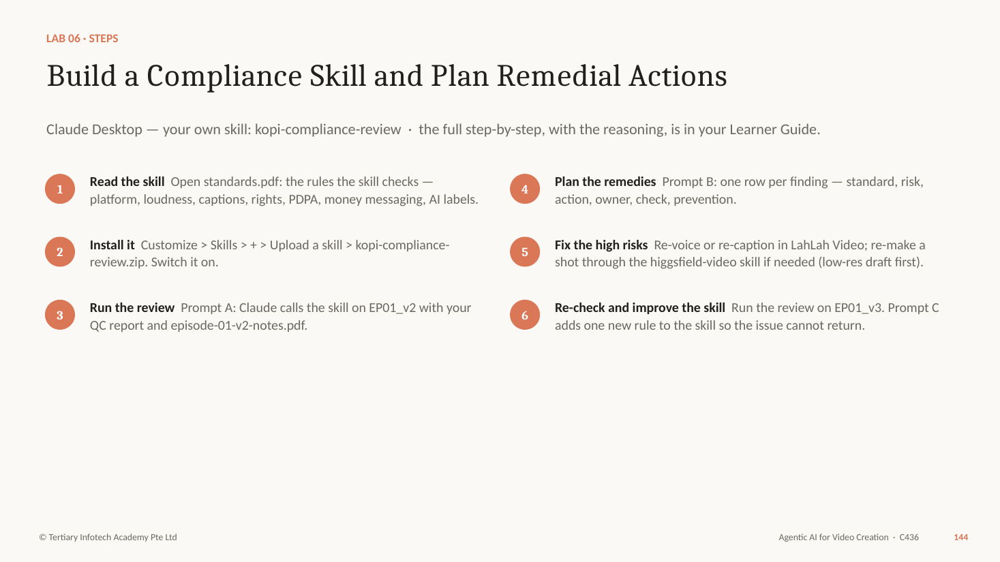

Figure — Lab 6 workflow (slide 144)

**Why each step matters**

- A compliance skill makes review repeatable: the same checks, the same order, the same evidence, every episode. It never edits the video and never approves — only a person approves.
- Industry standards are the knowledge at work here: loudness (EBU R128 for broadcast, about -14 LUFS for social), platform specifications, WCAG captions, the Copyright Act 2021, the PDPA, the Financial Advisers Act, the ASAS advertising code, and TikTok and YouTube rules for labelling AI content.
- A remedial action plan is the ability at work here: each finding gets the standard it breaks, a risk level, a corrective action, an owner, a way to verify the fix and a way to stop it recurring.
- The last step is the one that makes the studio better. When a finding repeats, add a rule to the skill — and the next episode is checked for it automatically.

**Step-by-step**

1. **Read the skill** — Open standards.pdf: the rules the skill checks — platform, loudness, captions, rights, PDPA, money messaging, AI labels.
1. **Install it** — Customize > Skills > + > Upload a skill > kopi-compliance-review.zip. Switch it on.
1. **Run the review** — Prompt A: Claude calls the skill on EP01_v2 with your QC report and episode-01-v2-notes.pdf.
1. **Plan the remedies** — Prompt B: one row per finding — standard, risk, action, owner, check, prevention.
1. **Fix the high risks** — Re-voice or re-caption in LahLah Video; re-make a shot through the higgsfield-video skill if needed (low-res draft first).
1. **Re-check and improve the skill** — Run the review on EP01_v3. Prompt C adds one new rule to the skill so the issue cannot return.

**PROMPT A — run the compliance review**

> Use the kopi-compliance-review skill on Episode 1 v2.

> Evidence: my QC report, captions.srt, the approved script, the music licence note and episode-01-v2-notes.pdf (attached).

> One row per finding: standard, evidence (timecode, frame or reading), risk (high, medium, low) with a reason, and the remedial action. Mark anything you cannot verify as UNVERIFIED. Do not approve the episode.

**PROMPT B — remedial action plan**

> Turn the findings into a remedial action plan as CSV:
> finding, standard, risk, corrective action, owner, due, how we verify the fix, how we prevent it recurring.

> Order by risk, high first. Where the fix is a re-make, name the shot ID and the higgsfield-video prompt change, drafted low-res before 1080p.

**PROMPT C — improve the skill**

> The finding "[FINDING]" came from a gap in our process. Draft one new rule for the kopi-compliance-review skill that would catch it next time: the rule, how to check it, the evidence to record. Show the updated SKILL.md section so I can paste it in and re-upload the skill.

**Check your work**

- ☐  kopi-compliance-review shows under Customize > Skills and is on.
- ☐  The compliance report lists every finding with standard, evidence and risk.
- ☐  The remedial plan has an owner, a check and a prevention for each finding, high risks first.
- ☐  High-risk findings are fixed in EP01_v3.
- ☐  The re-run review shows no high-risk findings.
- ☐  One new rule drafted for the skill.

**If it goes wrong**

- **The skill does not load** — Name it: "use the kopi-compliance-review skill". Check it is switched on.
- **Findings without evidence** — Reply: "Give the timecode, frame or reading for every finding."

**Stretch**

- Ask Claude to run the review on a deliberately broken cut (music too loud, captions too low) and check it catches both.

Fix the process, not just the episode. A rule added to the skill today is a finding you never see again.

### Key ideas for Lab 7

#### Publishing: What Each Platform Asks For

The platform-publish skill prepares export settings, title, description, hashtags and the AI-content label for TikTok, YouTube, Shorts or Reels. Uploads stay private or draft until a person publishes them.

The platform-publish skill prepares all of this; you press the button.

| Platform | Export | AI label | Upload as |
|---|---|---|---|
| TikTok | 1080x1920, H.264 MP4, 30 fps | More options > AI-generated content | Draft, or private |
| YouTube Shorts | 1080x1920, up to 3 min | Studio > Attributes > AI use | Private, then scheduled |
| YouTube | 1920x1080, H.264, about 8 Mbps | Studio > Attributes > AI use | Private, then scheduled |
| Instagram Reels | 1080x1920; 35% bottom clear | AI label toggle (awaiting verification) | Draft |

Tip: Higgsfield's connector can post to TikTok; the course skills never do it without your explicit yes.

#### Technologies That Improve Efficiency and Quality

Each new technology improves something specific — agents with connectors remove copy-paste, skills repeat know-how, presets bring film language, references hold faces, voice commands speed editing — and brings a risk to manage. Knowing both is what lets you recommend it responsibly.

What each technology improves — and the risk to manage.

| Technology | Improves | Watch for |
|---|---|---|
| Agents with MCP connectors | Claude calls Higgsfield directly; no copy-paste between apps. | Credit spend; tool names change. |
| Skills | Studio know-how applied the same way every time. | Stale or untrusted skills. |
| Cinematic presets and models | Film language in one word: Dolly In, Crash Zoom. | Over-styled, show-off shots. |
| Reference stills and Soul ID | Consistent faces across shots and episodes. | Likeness and consent of real people. |
| Voice-driven editing | LahLah Voice + LahLah Video: hands-free cuts. | Misheard commands — keep undo close. |
| Always-on agents and schedules | A weekly cadence (e.g. Hermes Agent with cron). | Publishing work nobody approved. |

#### Facilitating the Adoption of New Technology

Adoption is a change process: measure a baseline, run a small pilot with clear success measures, train people, put governance in place, measure weekly and decide with evidence whether to scale.

A new tool is adopted when people use it well — not when it is installed.

1. **Baseline** — Measure today: time, credits and rework per episode.
1. **Pilot** — Four weeks, one series, a small team, clear success measures.
1. **Train** — Hands-on sessions, the skills and Prompt Builder, a champion per team.
1. **Govern** — Approval gates, credit caps, low-res-first, the compliance skill, AI labels.
1. **Measure** — Weekly metrics against the baseline.
1. **Decide** — Scale, adjust or stop — with evidence.

#### Five Numbers That Decide Whether to Scale

Track these weekly during the pilot. Decide with numbers.

| Metric | Measures | Pilot target (example) |
|---|---|---|
| Time per episode | Hours from brief to approved cut. | Halve the baseline. |
| Credits per episode | Generation cost, drafts plus finals. | Within budget; falling week on week. |
| Draft-to-final ratio | Low-res drafts per approved 1080p shot. | Under 3 — fewer wasted upgrades. |
| First-pass compliance | Episodes passing review first time. | 80% or more. |
| Audience response | Completion rate, saves and shares. | At or above the baseline. |

### Lab 7 — Mini Capstone: Your Own Short Film, Idea to Upload

**The story so far:** Priya hands you the studio for an hour: make any short film you like (a micro-drama, an ad, a music clip, a family story) from idea to a private upload, then write the plan that makes this way of working stick. Ah Ma's Love Letter is the worked example.

**Goal:** Prove you can run the whole pipeline on a story of your own: approve the board, generate on a budget, cut, check, publish privately with the AI label on, and plan the adoption with your own numbers.

**You'll produce:** Project "Capstone – [FILM TITLE]"; your film exported as EP02_v1.mp4; a private or draft upload with the AI label on; an adoption plan

**Agent:** Claude Desktop + Higgsfield + LahLah Video — all skills, platform-publish  ·  **Time:** 70 min  ·  **Slides:** 153–159

**Lab folder:** labs/lab-07-mini-capstone-your-own-short-film/ — assets/short-film-brief-template.pdf, assets/project-capstone-setup.pdf, assets/publish-checklist.pdf, assets/adoption-plan-template.pdf, assets/sample/short-film-brief.pdf, assets/sample/upload-plan.pdf, assets/sample/adoption-plan.pdf, assets/optional/episode-02-brief.pdf

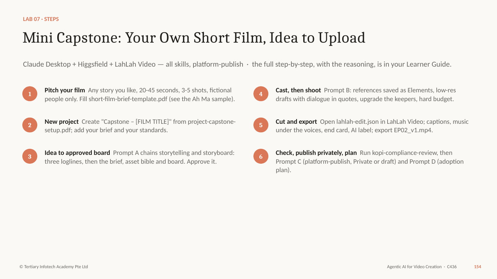

Figure — Lab 7 workflow (slide 154)

**Why each step matters**

- This lab is the whole course in one hour on a story you chose: idea, prompt, story, storyboard, script, Higgsfield, edit, review, publish. The skills carry the know-how, so each step is one prompt.
- Keep it small. Three to five shots of 5 seconds, one location, two characters at most. Ah Ma's Love Letter is four shots, three references and about 14 credits.
- Export your film as EP02_v1.mp4 and keep the screenshot of the private upload settings with the AI label on.
- platform-publish prepares everything a platform asks for: export settings, title, description, hashtags, a thumbnail prompt and the AI disclosure. It never posts without your explicit yes.
- Adopting a new technology means people use it well, not that it is installed. Measure a baseline, run a small pilot, train, govern (credit caps, low-res drafts before 1080p, approval gates, the compliance skill), then decide with numbers.

**Step-by-step**

1. **Pitch your film** — Any story you like, 20-45 seconds, 3-5 shots, fictional people only. Fill short-film-brief-template.pdf (see the Ah Ma sample).
1. **New project** — Create "Capstone – [FILM TITLE]" from project-capstone-setup.pdf; add your brief and your standards.
1. **Idea to approved board** — Prompt A chains storytelling and storyboard: three loglines, then the brief, asset bible and board. Approve it.
1. **Cast, then shoot** — Prompt B: references saved as Elements, low-res drafts with dialogue in quotes, upgrade the keepers, hard budget.
1. **Cut and export** — Open lahlah-edit.json in LahLah Video; captions, music under the voices, end card, AI label; export EP02_v1.mp4.
1. **Check, publish privately, plan** — Run kopi-compliance-review, then Prompt C (platform-publish, Private or draft) and Prompt D (adoption plan).

**PROMPT A — your idea to an approved storyboard**

> Use the storytelling skill, then the storyboard skill.

> My short film: [ONE-LINE IDEA]. Genre [GENRE], for [PLATFORM], 9:16, [LENGTH: 20-45] seconds, [3-5] shots, fictional characters only: [WHO].

> Give me three loglines and stop. After I pick one, write the brief, the asset bible (characters, location, props) and the storyboard artifact marked DRAFT, then stop for my approval.

**PROMPT B — cast, then shoot on a hard budget**

> Use the video-script skill on the approved storyboard, then the higgsfield-video skill.

> 1. References first: one 9:16 still per character, location and key prop; save the ones I approve as Elements.
> 2. Draft every shot at 480p on Seedance 2.0 Mini, sound on; put each spoken line in quotes with the speaker named.
> 3. Upgrade to 1080p only the drafts I approve.

> Hard limit: [BUDGET] credits in total; ask before each batch. Higgsfield project: "Capstone – [FILM TITLE]". Finish with the status table, download links, lahlah-edit.json (fps = the clips' frame rate) and captions.srt.

**PROMPT C — publish privately (platform-publish skill)**

> Use the platform-publish skill for EP02_v1 ("[FILM TITLE]") on [PLATFORM].

> Give me: export settings, a title under 60 characters, a description with the AI disclosure, five hashtags, a thumbnail prompt, and the exact clicks to switch on the AI-content label. The upload stays Private (YouTube) or a draft (TikTok). Do not publish anything yourself.

**PROMPT D — adoption plan**

> Write an adoption plan for running Kopi & Coins on Claude, Higgsfield and LahLah Video.

> Use my numbers: Episode 1 took [HOURS] hours and [CREDITS] credits; my capstone film took [HOURS] hours and [CREDITS] credits; low-res drafting saved about [SAVED] credits.

> Sections: baseline; a 4-week pilot (scope, team); at least four metrics with targets; training and support; governance (credit caps, low-res-first rule, approval gates, the compliance skill, AI labels, who may publish); the decision point to scale, adjust or stop.

**Check your work**

- ☐  Your capstone project holds the brief, the approved storyboard and the approved script.
- ☐  References saved as Elements; every shot drafted low-res and the keepers upgraded within budget.
- ☐  EP02_v1.mp4 exported: your film, 9:16, captions on, AI label on the end card.
- ☐  The compliance review shows no high-risk findings.
- ☐  A screenshot shows the private or draft upload with the AI label switched on.
- ☐  The adoption plan has a baseline, a pilot, four metrics with targets, governance and a decision point.

**If it goes wrong**

- **Out of credits** — Keep the low-res drafts and use the mock clips from Lab 5 for missing shots; the pipeline is the evidence.
- **Stuck for an idea** — Remake a family memory, a product you love, or a 20-second twist on a proverb. Or make Episode 2 of Kopi & Coins.
- **No TikTok or YouTube account** — Show the upload plan from Prompt C and a screenshot of the settings page; do not create accounts in class.

**Stretch**

- Ask Claude to turn your film into episode 1 of a series: three more loglines and a credit budget per episode.

Small and finished beats big and broken. Four good shots and a clean upload are the capstone.

### Key ideas: the ethics of GenAI video

#### AI Video Has a Bill, and Someone Else Pays It

Close Topic 3 with the cost side of GenAI video. In January 2024 a finance worker at Arup in Hong Kong joined a video call with the company's "CFO" and colleagues, all deepfakes built from public footage, and made 15 transfers totalling HK$200 million (about US$25.6 million). CISAC's study with PMP Strategy puts 21% of audiovisual creators' revenue at risk by 2028, and 56% for dubbing and subtitling translators. MIT Technology Review measured about 3.4 million joules for one 5-second AI video, 700 times a high-quality image. In June 2025 Disney and Universal sued Midjourney for copying their characters, and Warner Bros. Discovery followed in September 2025. Which of these did your own capstone touch?

Four numbers behind the ethics of GenAI video. Every clip you generate sits on top of them.

- **$25M — One deepfake video call.** An Arup worker in Hong Kong sent HK$200M in 15 transfers after a call where the "CFO" and every colleague were deepfakes. (Hong Kong Police via CNN, Feb 2024)
- **21% — Creators' income at risk.** Share of audiovisual creators' revenue at risk from GenAI by 2028. Dubbing and subtitling translators: 56%. (CISAC / PMP Strategy, Dec 2024)
- **700× — Energy of one 5-second clip.** About 3.4 million joules: 700 times a high-quality AI image, or a microwave running for over an hour. (MIT Technology Review, May 2025)
- **3 — Studios suing Midjourney.** Disney and Universal in June 2025 ("a bottomless pit of plagiarism"), then Warner Bros. Discovery over Superman and Batman. (CNBC, Jun 2025; AP, Sept 2025)

Tip: Your capstone film already made these choices: whose face, whose style, how many drafts, and whether the label is on.

#### Seven Lines Your Studio Never Crosses

Seven ethical issues run through every AI video. Consent and likeness: the 2023 SAG-AFTRA contract requires consent and pay before a digital replica of an actor is made or used. Copyright: studios are suing image and video generators over training data and look-alike characters, so never prompt a named film, artist or character. Deepfakes: synthetic video of real people erodes trust in footage and enables fraud. Jobs: creators face real income loss, so credit and pay the people you work with. Bias: Bloomberg's review of 5,100 Stable Diffusion images found it exaggerates race and gender stereotypes, so cast deliberately. Environment: video generation is energy-hungry, which is one more reason to draft at 480p and upgrade only the keepers. Transparency: label AI media at upload; in Singapore, realistic deepfakes of election candidates are banned during elections under the 2024 amendment Act.

The core ethical issues of GenAI video, each with a real case and the rule you follow in Claude and Higgsfield.

| Issue | What already happened | Your rule |
|---|---|---|
| Consent and likeness | SAG-AFTRA's 2023 deal: no digital replica of an actor without consent and pay. | No real face or voice without written consent. |
| Copyright and creators | Disney, Universal and Warner Bros. Discovery v. Midjourney, 2025. | Never prompt a named film, artist or character. |
| Deepfakes and misinformation | Arup lost HK$200 million to a deepfake video call. | No realistic fakes of real people or events. |
| Jobs and income | CISAC: 21% of audiovisual creators' income at risk by 2028. | Credit and pay the humans in your pipeline. |
| Bias and representation | Bloomberg: 5,100 Stable Diffusion faces made CEOs white men and fast-food workers dark-skinned. | Cast on purpose; check who plays which role. |
| Environmental cost | One 5-second clip ≈ an hour of a microwave (MIT Technology Review). | Draft at 480p; upgrade only the keepers. |
| Transparency and labels | Singapore bans deepfakes of election candidates (2024 amendment Act). | AI label on at upload, every time. |

### Topic 3 recap

#### Kopi & Coins Is Now a Studio, Not a One-Off

Your studio now plans, shoots, checks and publishes. You approve.

- **Repeatable — Lab 6** — Your own compliance skill, a remedial plan and a v3 that passes.
- **Published — Lab 7** — Your capstone short film, from idea to a private upload with the AI label on, in one session.
- **Adopted** — An adoption plan with a baseline, a pilot, metrics and governance.
- **Accountable** — Seven studio rules: consent, copyright, deepfakes, jobs, bias, energy and the AI label.

## Course Summary

#### Kopi & Coins: Idea to Upload

Two days, one Claude studio, one series.

1. **Plan · LO1** — Skills, connector and project set up; brief, script, script review, approved storyboard, standards, work plan.
1. **Make · LO2** — Higgsfield shots drafted low-res and upgraded; a cut in LahLah Video; story and technical review; v2.
1. **Scale · LO3** — A compliance skill and remedies; your own short film end to end, published privately; an adoption plan.

## Quick Command Reference

| Command or prompt | What it does |
|---|---|
| Settings > Capabilities > Code execution and file creation | Turn on before uploading skills (Claude Desktop) |
| Customize > Skills > + > Upload a skill | Install a skill ZIP |
| Customize > Connectors > + > Add custom connector · https://mcp.higgsfield.ai/mcp | Connect Higgsfield to Claude |
| + > Connectors (in a chat) | Switch the Higgsfield connector on |
| + New Project > Set project instructions | Create a project per video |
| "Use the <skill> skill on …" | Call a skill by name |
| balance · models_explore · presets_show | Higgsfield tools: credits, models and costs, camera presets |
| generate_image · generate_video_batch · jobs_wait | Higgsfield tools: stills, shots, status and result links |
| curl -fsSL https://raw.githubusercontent.com/alfredang/LahLahVideo/main/install/install.sh / bash | Install LahLah Video (macOS) |
| irm https://raw.githubusercontent.com/alfredang/LahLahVideo/main/install/install.ps1 / iex | Install LahLah Video (Windows PowerShell) |
| Cmd/Ctrl+K | LahLah Video command bar (type or dictate) |
| ffprobe … / ffmpeg -af loudnorm=print_format=summary | Measure resolution, frame rate, duration and loudness |

## Glossary

| Term | Meaning |
|---|---|
| Agentic AI | AI that plans, uses tools and checks its work to complete a task; task-oriented, need not run 24/7. |
| AI agent | An always-on agent with long-term memory, tools and skills, started by people, schedules or messages. |
| Reference still | An approved image of a character or prop that every shot animates from. |
| Soul ID | Higgsfield's trained character identity from 5-20 photos. |
| Camera preset | A named Higgsfield camera move, e.g. Dolly In, Crash Zoom In. |
| Low-res draft | A cheap 480p or 720p test of a shot; only approved drafts are upgraded to 1080p. |
| Approval gate | A point where Claude stops until you reply APPROVED. |
| Artifact | A document Claude shows beside the chat, such as the storyboard. |
| lahlah-edit.json | The hand-off file Claude writes for LahLah Video: clips, trims, transitions, captions. |
| Skill | A folder of instructions (SKILL.md) an agent loads when a task matches. |
| MCP | Model Context Protocol: connects an agent to an outside server's tools — here, Higgsfield. |
| Connector | An MCP server added to Claude, such as Higgsfield. |
| Project (Claude) | One video's instructions, files and chats in one place. |
| LUFS | Loudness Units relative to Full Scale — perceived loudness. |
| dBTP | Decibels true peak — the highest true signal level. |
| Safe zone | The part of a vertical frame not covered by platform buttons and captions. |
| Continuity | Keeping characters, props, light and direction consistent between shots. |

## References

- Course page — https://www.tertiarycourses.com.sg/agentic-ai-for-video-creation.html
- Higgsfield — https://higgsfield.ai/
- Higgsfield — connect Higgsfield to an AI agent (MCP) — https://higgsfield.ai/creator-hub/help-center/integrations/how-do-i-connect-higgsfield-to-ai-agent
- Higgsfield — what is Higgsfield MCP — https://higgsfield.ai/creator-hub/help-center/integrations/what-is-higgsfield-mcp
- Higgsfield API docs — https://docs.higgsfield.ai/docs
- Metics Media (30 Oct 2026) Higgsfield AI Tutorial for Beginners (2026), 24:36 — https://www.youtube.com/watch?v=Mt91SiQotOU
- Higgsfield Camera Controls — https://higgsfield.ai/camera-controls
- Higgsfield pricing explained — https://higgsfield.ai/blog/higgsfield-pricing-explained
- Higgsfield — about (users and generations) — https://higgsfield.ai/about
- Scalekit — Higgsfield MCP tool catalogue — https://www.scalekit.com/connectors/higgsfieldmcp
- Claude Help — custom connectors (remote MCP) — https://support.claude.com/en/articles/11175166-get-started-with-custom-connectors-using-remote-mcp
- Claude Help — use skills in Claude — https://support.claude.com/en/articles/12512180-use-skills-in-claude
- Claude Help — create custom skills — https://support.claude.com/en/articles/12512198-how-to-create-custom-skills
- Claude Help — projects — https://support.claude.com/en/articles/9519177-how-can-i-create-and-manage-projects
- LahLah Video (open source) — https://github.com/alfredang/LahLahVideo
- CapCut Help — import subtitles — https://www.capcut.com/help/how-to-import-subtitles
- TikTok — AI-generated content — https://support.tiktok.com/en/using-tiktok/creating-videos/ai-generated-content
- YouTube Help — Disclosing altered or synthetic content — https://support.google.com/youtube/answer/14328491
- Instagram Help — Reels — https://help.instagram.com/2720958398006062/
- Isa does AI (2026) How to Make a Micro Drama with AI (Full Guide) — https://www.youtube.com/watch?v=vIksC7naeHo
- 喆FILM (2026) 过来人 The OGs (AI music video) — https://youtu.be/eKynQcweb7M
- The MacDoctor (6 Nov 2026) MV teardown: 过来人 The OGs, for a Claude + Higgsfield rebuild — supplied by the course owner
- Deadline (Jun 2026) Microdramas and AI at ReelShort — https://deadline.com/2026/06/microdrama-ai-reelshort-joey-jia-crazy-maple-studio-asia-1236958231
- EBU R 128 Loudness normalisation and permitted maximum level — https://tech.ebu.ch/publications/r128
- W3C WCAG 2.2 — 1.2.2 Captions (Prerecorded) — https://www.w3.org/TR/WCAG22/
- Personal Data Protection Commission (PDPA) — https://www.pdpc.gov.sg/
- Monetary Authority of Singapore — Financial Advisers Act — https://www.mas.gov.sg/
- Advertising Standards Authority of Singapore — SCAP — https://asas.org.sg/
- Intellectual Property Office of Singapore — Copyright — https://www.ipos.gov.sg/
- C2PA Content Credentials — https://c2pa.org/
- The Hollywood Reporter (2026) Two-thirds of microdramas released in the latest quarter outside China were AI generated (Owl & Co.) — https://www.hollywoodreporter.com/business/digital/ai-generated-microdramas-two-thirds-all-releases-1236735402
- Billboard (Sept 2025) AI music artist Xania Monet signs multimillion-dollar record deal — https://www.billboard.com/pro/ai-music-artist-xania-monet-multimillion-dollar-record-deal
- Business Insider (Nov 2023) Meet the AI model earning up to $11,000 a month — https://www.businessinsider.com/ai-influencer-aitana-clueless-agency-tech-spain-2023-11
- Theoretically Media (2 Nov 2026) PLANET HELL, AI sci-fi short (Seedance 2.5) — https://www.youtube.com/watch?v=1yLAbK5F3E8
- LahLah Video install scripts (Mac and Windows) — https://github.com/alfredang/LahLahVideo#1-minute-install
- CNN (4 Feb 2024) Finance worker pays out $25 million after video call with deepfake "chief financial officer" — https://www.cnn.com/2024/02/04/asia/deepfake-cfo-scam-hong-kong-intl-hnk
- CISAC / PMP Strategy (Dec 2024) Study on the economic impact of generative AI in music and audiovisual — https://www.cisac.org/services/reports-and-research/cisacpmp-strategy-ai-study
- MIT Technology Review (20 May 2025) We did the math on AI's energy footprint — https://www.technologyreview.com/2025/05/20/1116327/ai-energy-usage-climate-footprint-big-tech
- CNBC (11 Jun 2025) Disney and Universal sue Midjourney for AI copyright infringement — https://www.cnbc.com/2025/06/11/disney-universal-midjourney-ai-copyright.html
- AP News (Sept 2025) Warner Bros. sues Midjourney for copyright infringement — https://apnews.com/article/warner-bros-midjourney-ai-copyright-lawsuit-dc-studios-b87d80d7b4a4dfdcf0ee149d30830551
- Bloomberg (2023) Generative AI takes stereotypes and bias from bad to worse — https://www.bloomberg.com/graphics/2023-generative-ai-bias
- SAG-AFTRA (2023) TV/Theatrical contract: AI and digital replica FAQs — https://www.sagaftra.org/sites/default/files/sa_documents/AIFAQs.pdf
- Elections (Integrity of Online Advertising) (Amendment) Act 2024, Singapore Statutes Online — https://sso.agc.gov.sg/Acts-Supp/34-2024/Published/20241121?DocDate=20241121

## Support

Tertiary Infotech Academy Pte Ltd · enquiry@tertiaryinfotech.com · +65 6100 0613 · www.tertiarycourses.com.sg

Your trainer shares the slides, the Learner Guide and the lab pack at the start of the course.
